# M/s. Eshayat Enterprise — Complete Public Intelligence & Content Archive

> **Scraped From:** [https://www.facebook.com/mseshayatenterprise](https://www.facebook.com/mseshayatenterprise)  
> **Archive Generated:** 2026-10-11 11:30:30  
> **Total Images Downloaded:** 62 high-resolution files (`images/branding/` & `images/posts/`)  
> **Total Videos/Reels Downloaded:** 10 MP4 videos (`videos/`)  
> **Total Posts & Photo Records:** 66  
> **Total Public Comments Captured:** 4 (Reviews: 0 — *'Not yet rated (0 reviews)'*)

---

## 1. Company Identity & Contact Information

| Field | Value |
|---|---|
| **Official Name** | **M/s. Eshayat Enterprise** (also styled as *M/S Eshayat Enterprise* / *M/s.Eshayat Enterprise*) |
| **Tagline / Slogan** | *Quality • Reliability • Trust — Your Trusted Partner for Industrial & Laboratory Solutions* |
| **Bengali Intro** | *Industrial Safety, PPE, Laboratory Glassware, Scientific Supplies & MRO Products-এর বিশ্বস্ত সরবরাহকারী। মানসম্মত পণ্য ও নির্ভরযোগ্য সেবায় আপনার Trusted Industrial Partner — M/s. Eshayat Enterprise.* |
| **Facebook URL** | `https://www.facebook.com/mseshayatenterprise` (also referenced in posts as `facebook.com/eshayat.enterprise`) |
| **Facebook Page ID** | `1256996357495715` (Uploader/Delegate ID: `61592771081245`) |
| **Category** | Commercial and Industrial Equipment Supplier |
| **Business Role** | Importer, Supplier, Wholesaler & OEM/ODM Solutions Provider of Laboratory, Industrial Safety, Cleanroom & Technical Equipment |
| **Page Creation Date** | August 7 (per Facebook Page Transparency) |
| **Followers / Following** | **3.6K followers** • **3 following** |
| **New Follower Shoutout** | Mergan Shuvo, Sadiq Ahmed, Obaidur Rahman Sakib, Julichia Benie, Naira Victorino Marques |
| **Primary Phone / WhatsApp** | `+880 1862-679456` (`01862679456`) |
| **Secondary Sales Phone** | `+880 1309-816266` (`01309816266`) |
| **Additional Phones (Posters)** | `+880 1887-333032`, `+880 1886-276358`, `+880 1630-200454` |
| **Email Address** | `eshayat.enterprise@outlook.com` |
| **Website Mentioned** | `www.eshayatenterprise.com` (`eshayatenterprise.com`) |
| **Physical Address** | `1035/1` (also written as `1305/1` in several posts), East Shewrapara, Mirpur, Kafrul PS, Dhaka-1216, Bangladesh |
| **Operating Hours** | Always Open |
| **Reviews / Rating** | Not yet rated (0 reviews) |
| **Active Ads** | None (*'This Page isn't currently running ads'*) |

### Branding Assets
- **Profile Logo:** [`images/branding/003_767793945_122103034311425702_8369019421966702579_n.jpg`](images/branding/003_767793945_122103034311425702_8369019421966702579_n.jpg) (1254×1254)
- **Cover Banner:** [`images/branding/004_768148887_122102732217425702_1776836872297195546_n.png`](images/branding/004_768148887_122102732217425702_1776836872297195546_n.png) (1942×809)
- **Page Overview Screenshot:** [`page_overview_screenshot.png`](page_overview_screenshot.png)

---

## 2. Complete Product & Service Portfolio

### Laboratory Equipment, Consumables & Scientific Glassware
- Peristaltic Pumps (Models: BT600FC & CF3000 — smart touch-screen fluid transfer)
- Micropipettes (DLAB HiPette, QIUJING Adjustable 20–200 µL with 2-year warranty, Discovery-H Single-Channel 10–100 µL, 20–200 µL, 100–1000 µL, 0.5–5 mL)
- Class A Volumetric Pipettes (Borosilicate glass, TD calibrated: 5 mL, 10 mL, 20 mL, 25 mL, 50 mL)
- Laboratory Reagent Bottles (Schott Duran 250 mL Made in Germany; Clear & Amber borosilicate screw-cap: 30 mL, 60 mL, 100 mL, 250 mL, 500 mL, 800 mL, 1000 mL, 2000 mL)
- 2mL Autosampler Vials with Screw Cap (Brands: BKMAM® & WQS® — Clear & Amber glass, PTFE/Silicone Septa, 32×12mm, 9mm neck)
- Petri Dishes (BKMAM® / BKMANLAB® / Labshark® — FDA, ISO, CE certified 100% virgin polystyrene: 55mm [2000 pcs/carton], 90mm [300 or 500 pcs/carton], 100mm, 150mm)
- KMN® Heat Seal Reel (Size: 300mm × 200m — sterilization & packaging reel for pharmaceutical, lab & industrial use)
- Stainless Steel Sintered Filters & Stainless Steel Mesh Filters (Fine mesh precision particle filtration, high-temp & corrosion resistant)
- Digital Calipers (150mm / 6" Stainless Steel, Metric & Inch conversion, digital display)
- General Lab Glassware (Beakers, Flasks, Test Tubes, Measuring Cylinders, Burettes, Funnels)
- Lab Accessories (Measuring & Weighing Instruments, Support & Heating Equipment, Storage & Cleaning)

### Personal Protective Equipment (PPE) & Workplace Safety
- Emergency Safety Shower & Eyewash Stations (Corrosion-resistant industrial/lab decontamination)
- Autoclave Safety Shoes (Cleanroom & pharma grade, withstands high-temp autoclave sterilization, anti-slip, chemical resistant)
- Industrial Safety Shoes & Boots (Steel toe cap, anti-slip, puncture protection)
- 1000V Electrical Safety Gloves (Blue & Green 1000V insulated, anti-slip, water-resistant)
- Industrial Hand Gloves (Chemical, cut, abrasion, heat & cold protection)
- Electrical Isolation Mats (High electrical insulation, anti-slip textured surface for switch/control rooms)
- Protective Eyewear & Safety Goggles (1710IN Protective Eyewear — special offer BDT 550/pc; anti-splash/dust goggles)
- Safety Helmets & OEM/ODM Hard Hats (EN 50365:2002 Class 0 Electrically Insulating up to 1000V AC / 1500V DC; Transparent High-Impact ABS Shell; integrated clear visor; 6-point harness; custom logo/color OEM & ODM)
- High-Visibility Reflective Safety Vests (Orange & Yellow fluorescent fabric with zipper)
- Full-Body Safety Harness & Shock-Absorbing Lanyards (Work at height protection)
- Industrial Ear Muffs & Ear Plugs (High-noise hearing protection)
- Respiratory Protection & Filters (EN 140:1998 & CE Certified Reusable Half-Face Respirator Masks; Gas/Vapour, Combined, Particulate & Pre-filters)

### Fire Safety & Emergency Equipment
- Fire Extinguishers
- Fire Blankets & Fire Cabinets
- Fire Alarms, Smoke Detectors, Emergency Lights & Fire Exit Signs
- Fire Fighting Suits, Helmets, Gloves & Boots
- Fire Hose, Hose Reels, Hydrant Systems, Fire Sand Shovels, Fire Axes, Bolt Cutters & Escape Ladders

### Cleanroom Design, Construction & Engineering
- Turnkey Cleanroom Design & Engineering (for Pharma Plants, QC Labs, Microbiology Labs, Healthcare)
- Modular Cleanroom Panels, Flooring, Ceiling & Lighting
- HVAC & Air Handling Systems with HEPA/ULPA Filtration
- Cleanroom Doors, Windows, Pass Boxes & Air Showers
- Temperature, Humidity & Pressure Control Systems

### MRO (Maintenance, Repair & Operations) & Industrial Batteries
- SAFT LS 17500 3.6V Li-SOCl2 Lithium Batteries (for Smart Meters, IoT, PLC/Memory Backup, Tracking)
- Hand Tools, Power Tools, Fasteners & Hardware
- Lubricants, Maintenance Chemicals, Adhesives, Tapes & Sealants
- Abrasives, Cutting Products, Cleaning & Janitorial Supplies

---

## 3. Public Comments, Customer Inquiries & Reviews

- **Facebook Reviews Tab (`/reviews`):** `Not yet rated (0 reviews)`
- **Facebook Mentions Tab (`/mentions`):** `No posts or tags`
- **Post Comments Captured:**

| Date (UTC) | Author | Comment / Reply |
|---|---|---|
| `2026-09-24T16:32:11+00:00` | **Nazareno Fernandez** | Magkano po |
| `2026-08-07T20:05:43+00:00` | **M/s.Eshayat Enterprise** | Inbox please. |
| `2026-08-07T19:59:48+00:00` | **Shaharin Alvi Badhan** | Pp |
| `2026-08-07T19:59:35+00:00` | **Shaharin Alvi Badhan** | Pp |

---

## 4. Downloaded Videos & Reels (10 MP4s)

| # | Video ID | Upload Date | Duration | Views | Title / Caption | Local File |
|---|---|---|---|---|---|---|
| 1 | `3562516980575711` | `20261009` | 15.0s | 7 | M/s.Eshayat Enterprise on Reels | [`videos/3562516980575711.mp4`](videos/3562516980575711.mp4) (434 KB) |
| 2 | `1649165890141145` | `20260919` | 56.614s | 25 | M/s.Eshayat Enterprise on Reels | [`videos/1649165890141145.mp4`](videos/1649165890141145.mp4) (9826 KB) |
| 3 | `1951415542912226` | `20260817` | 6.0s | 21 | 🏭 M/s. Eshayat Enterprise — Your Trusted Partner for Industrial & Laboratory ... | [`videos/1951415542912226.mp4`](videos/1951415542912226.mp4) (530 KB) |
| 4 | `4511596285779677` | `20260811` | 15.0s | 11 | M/s.Eshayat Enterprise on Reels | [`videos/4511596285779677.mp4`](videos/4511596285779677.mp4) (201 KB) |
| 5 | `1932112604142318` | `20260809` | 15.0s | 18 | #FireSafety #FireProtection #FireSafetyEquipment #FireFightingEquipment #Fire... | [`videos/1932112604142318.mp4`](videos/1932112604142318.mp4) (390 KB) |
| 6 | `934700506340265` | `20260807` | 12.6s | 49 | 12 reactions / 🔥 Check out our latest Reel! Quality • Reliability • Trust 👉 W... | [`videos/934700506340265.mp4`](videos/934700506340265.mp4) (273 KB) |
| 7 | `1365503891748074` | `20260807` | 12.2s | 15 | M/s.Eshayat Enterprise on Reels | [`videos/1365503891748074.mp4`](videos/1365503891748074.mp4) (712 KB) |
| 8 | `1352310487106659` | `20260807` | 12.6s | 2 | M/s.Eshayat Enterprise on Reels | [`videos/1352310487106659.mp4`](videos/1352310487106659.mp4) (272 KB) |
| 9 | `1700529531016321` | `20260807` | 15.0s | 9 | M/s.Eshayat Enterprise on Reels | [`videos/1700529531016321.mp4`](videos/1700529531016321.mp4) (379 KB) |
| 10 | `4447034305564188` | `20260807` | 12.6s | 29 | M/s.Eshayat Enterprise on Reels | [`videos/4447034305564188.mp4`](videos/4447034305564188.mp4) (434 KB) |

---

## 5. All Scraped Posts & Photo Content (66 Items)

### Post / Item #1
- **Post/Media ID:** `122122923279425702`
- **Published (UTC):** `2026-10-04T17:53:22+00:00`
- **Permalink:** https://www.facebook.com/mseshayatenterprise/posts/pfbid0bH3Cg8fx8SZr3vZhKNPpAQXKmitBW8TTycPQoVMJkqHvkbpxtsD7XX5ZrsEoaP9bl
- **Local Image(s):** [`images/posts/006_834249160_122122923291425702_1572646837667355227_n.jpg`](images/posts/006_834249160_122122923291425702_1572646837667355227_n.jpg)

```text
[Poster Text] M/S Eshayat Enterprise — 2mL Autosampler Vials with Screw Cap (Precision • Durability • Reliable Results)
Available Brands: BKMAM® | WQS®
• 2mL Capacity • Screw Cap (Secure & leak-proof) • High Quality Glass (Clear & amber options) • PTFE/Silicone Septa
Specifications: Volume 2 mL | Height 32 mm | Diameter (body) 12 mm | Neck (outer) 9 mm | Screw Cap Height 9 mm | Septum Thickness 6.2 mm
Contact: 01862679456 | Email: eshayat.enterprise@outlook.com | 1305/1, East Shewrapara, Kafrul PS, Mirpur, Dhaka
```

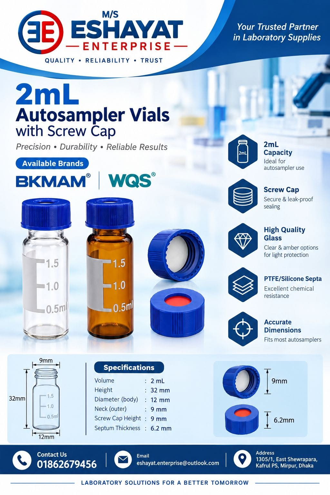

---

### Post / Item #2
- **Post/Media ID:** `122122278885425702`
- **Published (UTC):** `2026-10-02T05:23:57+00:00`
- **Permalink:** https://www.facebook.com/mseshayatenterprise/posts/pfbid02S3UHw2Z1yLaycSETsTcE9y7hHUzEkmWptTeKiNBRJ1j79fMVUcvE4iRFQiD6Ng24l
- **Local Image(s):** [`images/posts/007_829806189_122122278897425702_2300782937885866924_n.jpg`](images/posts/007_829806189_122122278897425702_2300782937885866924_n.jpg)

```text
🔬 Peristaltic Pump – Reliable Fluid Transfer Solution
Looking for accurate, stable, and reliable fluid transfer for your laboratory or industrial application?

M/S Eshayat Enterprise brings you Peristaltic Pump solutions suitable for:

✅ Pharmaceutical Industry
✅ Laboratory & Research
✅ Chemical Processing
✅ Water Treatment
✅ Food & Beverage
✅ Industrial Applications

Key Features:
🔹 Stable & accurate flow control
🔹 Multiple working modes
🔹 Low-noise operation
🔹 Smart touch-screen control
🔹 Durable & reliable performance

📌 Models: BT600FC & CF3000

For product details, quotation, or availability, please contact us.

📞 01862679456
📧 eshayat.enterprise@outlook.com
📍 1035/1, East Shewrapara, Mirpur, Kafrul PS, Dhaka-1216, Bangladesh

👉 Follow M/S Eshayat Enterprise for product updates and new arrivals.

#EshayatEnterprise #PeristalticPump #LaboratoryEquipment #PharmaceuticalIndustry #LabEquipment #ChemicalProcessing #WaterTreatment #IndustrialEquipment #Bangladesh
```

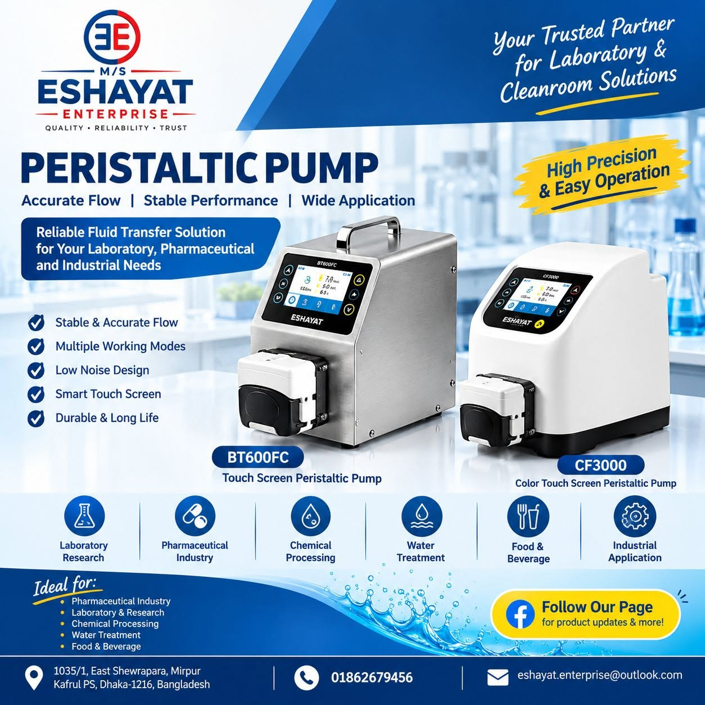

---

### Post / Item #3
- **Post/Media ID:** `122122186143425702`
- **Published (UTC):** `2026-10-01T19:06:25+00:00`
- **Permalink:** https://www.facebook.com/mseshayatenterprise/posts/pfbid0USpmrrVc1HPNsWwGgwWnGHQUYmSjsimB9y823cMA5DQ1bJrzU4zrMi3NL9iqeevFl
- **Local Image(s):** [`images/posts/008_830985381_122122186149425702_8759497747368981778_n.jpg`](images/posts/008_830985381_122122186149425702_8759497747368981778_n.jpg)

```text
[Poster Text] M/S Eshayat Enterprise — AUTOCLAVE SAFETY SHOE (Safety for Every Step — Ideal for Cleanroom & Pharmaceutical Environment)
• Autoclave Safe (Withstands high temperature sterilization) • Lightweight & Comfortable • Anti-Slip Sole • Chemical Resistant • Durable Construction
Applications: Pharmaceutical Industries | Laboratories | Hospitals | Cleanrooms | Sterilization Units
Contact: 01862679456 | Email: eshayat.enterprise@outlook.com | 1305/1, East Shewrapara, Kafrul, Dhaka, Bangladesh
```

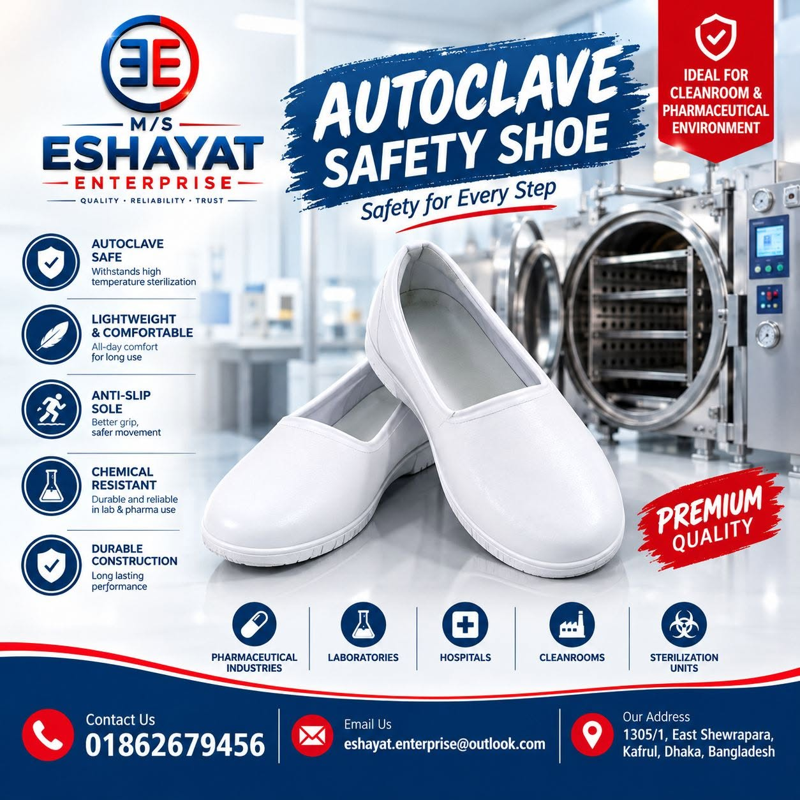

---

### Post / Item #4
- **Post/Media ID:** `122121740895425702`
- **Published (UTC):** `2026-09-29T20:36:39+00:00`
- **Permalink:** https://www.facebook.com/mseshayatenterprise/posts/pfbid02mN5NtbtTyRWmctUzvM63DANLPvZaCnGm8UEjJ4yoogk3QLoUXdyFzWxLaALYzBVNl
- **Local Image(s):** [`images/posts/009_825271258_122121740901425702_7584344091662790333_n.jpg`](images/posts/009_825271258_122121740901425702_7584344091662790333_n.jpg)

```text
🔬 Precision Filtration. Built to Perform.
Stainless Steel Mesh Filter — engineered for efficient filtration, durability, and dependable performance across laboratory, industrial, and research applications.
✨ Key Features:
• High-quality stainless steel construction
• Fine & efficient particle filtration
• Excellent corrosion resistance
• High-temperature stability
• Long-lasting & reliable performance
• Suitable for laboratory & industrial use
📦 Available Now at M/s. Eshayat Enterprise
📞 01309816266
📍 1305/1 East Shewrapara, Mirpur; Kafrul PS; Dhaka-1216
#EshayatEnterprise #StainlessSteelMeshFilter #MeshFilter #LaboratorySupplies #LabEquipment #Filtration #ScientificSolutions #IndustrialSupplies #LabAccessories
```

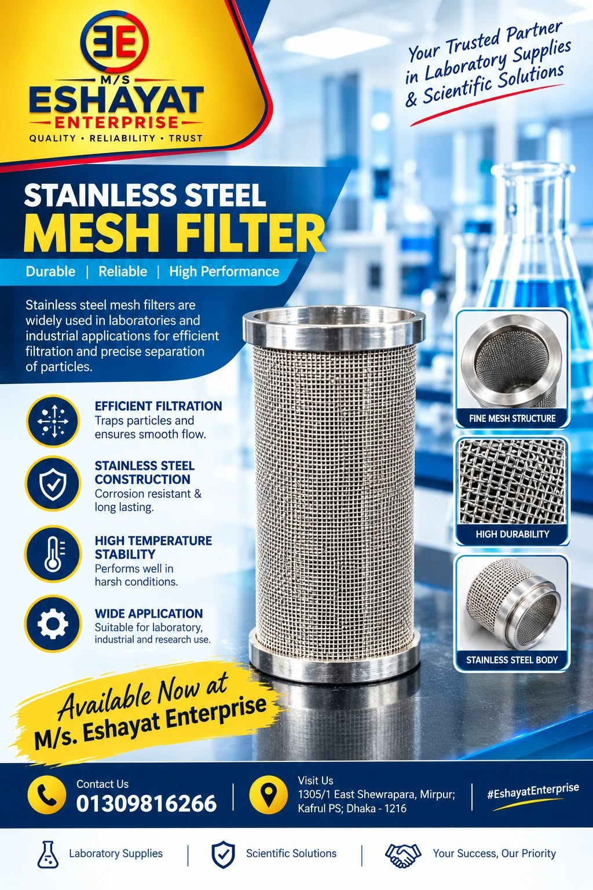

---

### Post / Item #5
- **Post/Media ID:** `122120651793425702`
- **Published (UTC):** `2026-09-25T14:09:23+00:00`
- **Permalink:** https://www.facebook.com/mseshayatenterprise/posts/pfbid02ZjNmvX8pWQaYnsZcyz7ujyTfuUErgE8Was7WNXQW5LdpfLd5ySmbMSzKeFPdmadLl
- **Local Image(s):** [`images/posts/010_823990555_122120651799425702_67622783528378197_n.jpg`](images/posts/010_823990555_122120651799425702_67622783528378197_n.jpg)

```text
WORLD PHARMACIST DAY — 25 SEPTEMBER 💊

Celebrating pharmacists for their dedication, knowledge, professionalism, and vital contribution to better health and well-being.

M/S ESHAYAT ENTERPRISE
Quality • Reliability • Trust
```


---

### Post / Item #6
- **Post/Media ID:** `122120137323425702`
- **Published (UTC):** `2026-09-24T04:53:45+00:00`
- **Permalink:** https://www.facebook.com/mseshayatenterprise/posts/pfbid0TP1dC9KAYmwPkmkKFF2eDYZ6EAWM1zyDzk2shtNSTCQZQUuBt6GMEPp65y8CVjT6l
- **Local Image(s):** [`images/posts/011_807284893_122120137329425702_867437913810175042_n.jpg`](images/posts/011_807284893_122120137329425702_867437913810175042_n.jpg)

```text
🚿 SAFETY SHOWER & EYEWASH STATION 👁️

Emergency Protection for Laboratories & Industries

M/s. Eshayat Enterprise brings you Safety Shower & Eyewash Stations designed for rapid emergency response when chemicals or hazardous substances come into contact with the body or eyes.

🔹 Emergency Eye & Face Washing
🔹 Full-Body Emergency Shower
🔹 Fast & Easy Activation
🔹 Suitable for Chemical & Industrial Areas
🔹 Reliable Safety Equipment for Workplace Protection

📍 Available at M/s. Eshayat Enterprise

📞 Contact: 01309816266
📍 Address: 1305/1 East Shewrapara, Mirpur, Kafrul PS, Dhaka-1216

#EshayatEnterprise #SafetyShower #EyewashStation #EmergencySafety #IndustrialSafety #LaboratorySafety #ChemicalSafety #SafetyEquipment #WorkplaceSafety #Bangladesh
```

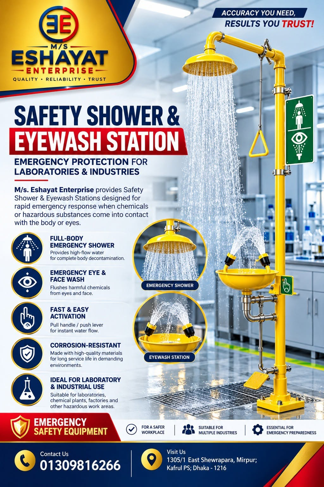

---

### Post / Item #7
- **Post/Media ID:** `1951415542912226`
- **Published (UTC):** `2026-08-17T20:39:23+00:00`
- **Local Image(s):** [`images/posts/014_777799244_28047015848267057_6873266548719062529_n.jpg`](images/posts/014_777799244_28047015848267057_6873266548719062529_n.jpg)

```text
🏭 M/s. Eshayat Enterprise — Your Trusted Partner for Industrial & Laboratory Solutions!

Quality products. Reliable service. Competitive pricing. 🤝

🔹 Industrial Safety Equipment & PPE
🔹 Laboratory Glassware & Scientific Supplies
🔹 MRO & Maintenance Products
🔹 Workplace Safety Solutions

From Laboratory to Industry, we’re committed to providing reliable products that support Safety, Quality & Efficiency. 🛡️⚙️

📞 Contact us for your industrial, laboratory & safety product requirements.

#EshayatEnterprise #IndustrialSafety #LaboratorySupplies #MRO #SafetyEquipment #PPE #LaboratoryGlassware #IndustrialProducts #Bangladesh #TrustedPartner
```

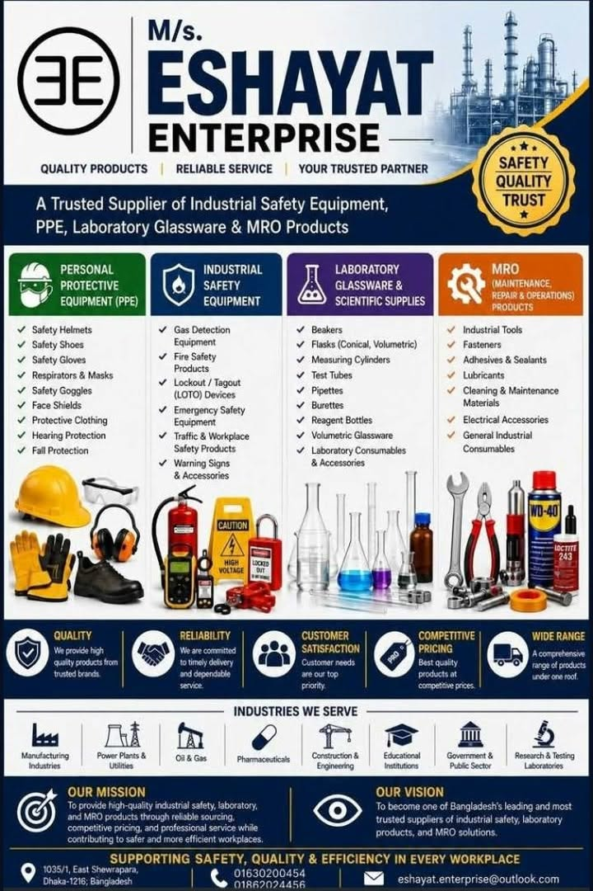

---

### Post / Item #8
- **Post/Media ID:** `1932112604142318`
- **Published (UTC):** `2026-08-09T02:44:50+00:00`
- **Local Image(s):** [`images/posts/016_768742358_3477536695761013_2844874738130858948_n.jpg`](images/posts/016_768742358_3477536695761013_2844874738130858948_n.jpg)

```text
#FireSafety #FireProtection #FireSafetyEquipment #FireFightingEquipment #FireExtinguisher #FireSafetyProducts #SafetyEquipment #IndustrialSafety #WorkplaceSafety #FireProtectionEquipment #PPE #SafetyFirst #OccupationalSafety #EmergencySafety #FirePrevention #SafetyAtWork #IndustrialSafetyEquipment
```

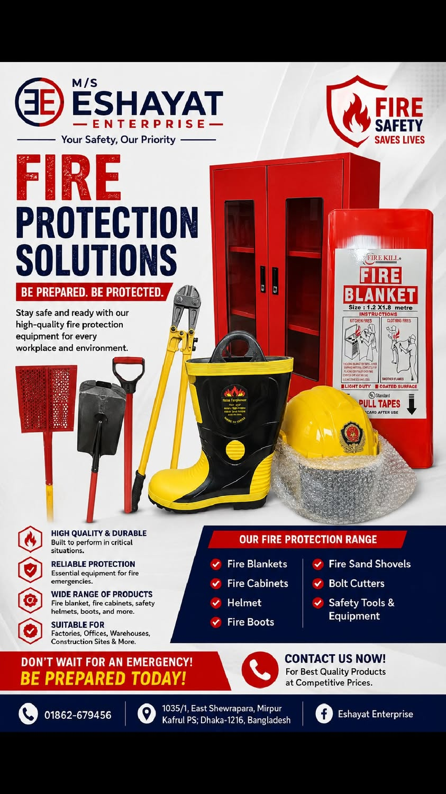

---

### Post / Item #9
- **Post/Media ID:** `934700506340265`
- **Published (UTC):** `2026-08-07T20:50:38+00:00`
- **Local Image(s):** [`images/posts/017_767268017_1637205628411171_386018688426510151_n.jpg`](images/posts/017_767268017_1637205628411171_386018688426510151_n.jpg)

```text
🔥 Check out our latest Reel!
Quality • Reliability • Trust
👉 Watch Now
#Eshayat_Enterprise
```

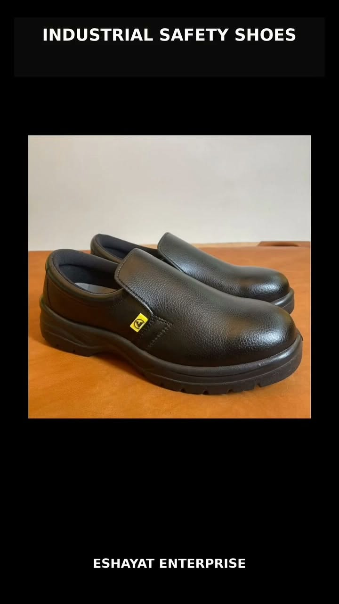

---

### Post / Item #10
- **Post/Media ID:** `122102749377425702`
- **Local Image(s):** [`images/posts/061_766072301_122102749383425702_4753030635785010699_n.jpg`](images/posts/061_766072301_122102749383425702_4753030635785010699_n.jpg), [`images/posts/062_765872470_122102728671425702_9185800020150433142_n.jpg`](images/posts/062_765872470_122102728671425702_9185800020150433142_n.jpg)

```text
#EshayatEnterprise #IndustrialSafety #SafetyEquipment #PPE #PPESupplier #PersonalProtectiveEquipment #LaboratoryEquipment #LaboratoryGlassware #ScientificSupplies #MROProducts #IndustrialTools #FireSafety #SafetyProducts #IndustrialSupplier #SafetyEquipmentBangladesh #PPESupplierBangladesh #Dhaka #bangladeshivlogger
```

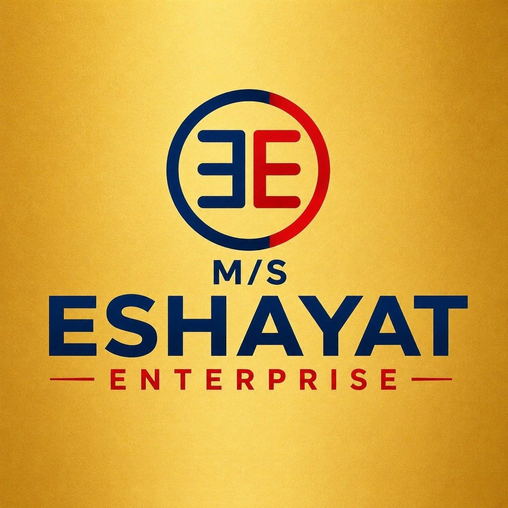

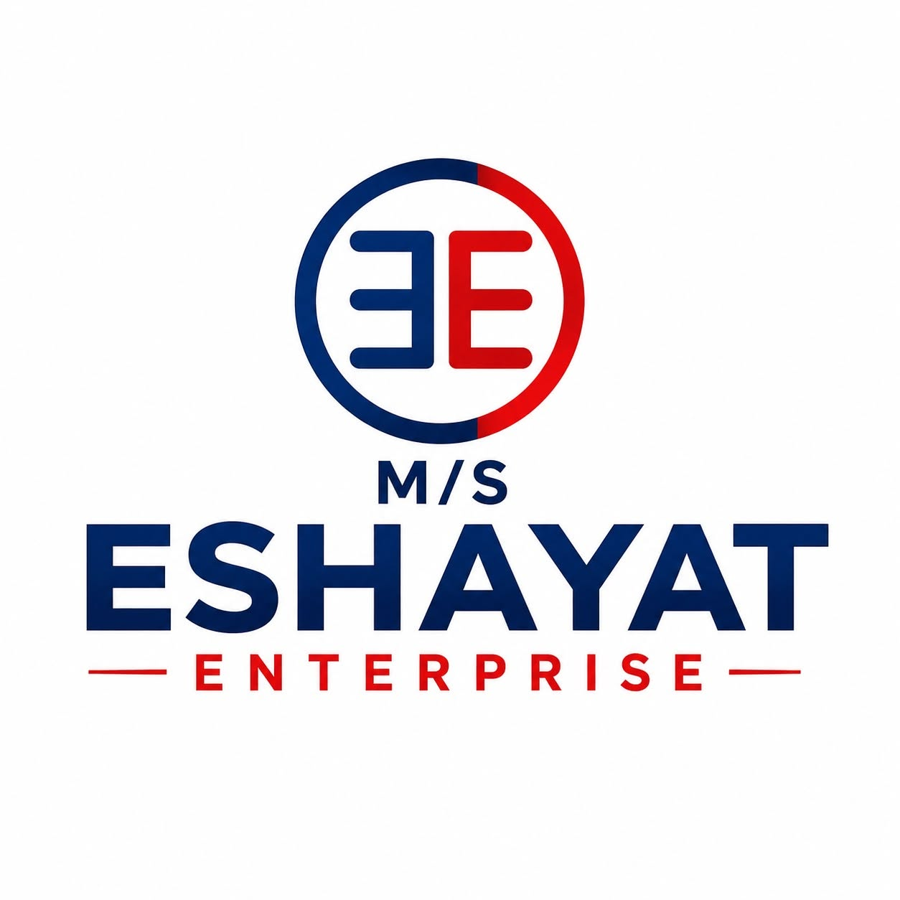

---

### Post / Item #11
- **Post/Media ID:** `122102832927425702`
- **Local Image(s):** [`images/posts/060_765997562_122102832933425702_4541473928226471980_n.jpg`](images/posts/060_765997562_122102832933425702_4541473928226471980_n.jpg)

```text
🔬 Premium Lab Glassware for Every Laboratory

Quality • Precision • Reliability — all from M/s. Eshayat Enterprise.

We supply a wide range of laboratory glassware for laboratories, research centers, educational institutions & industries.

🧪 Beakers | Flasks | Test Tubes | Measuring Cylinders | Pipettes | Petri Dishes | Funnels & More

📞 01862679456
📍 1035/1, East Shewrapara, Mirpur; Kafrul PS, Dhaka-1216

👉 Like & Follow Eshayat Enterprise for laboratory products and updates.

#EshayatEnterprise #LabGlassware #LaboratorySupplies #LabEquipment #ScientificGlassware #LaboratorySolutions #Bangladesh
```

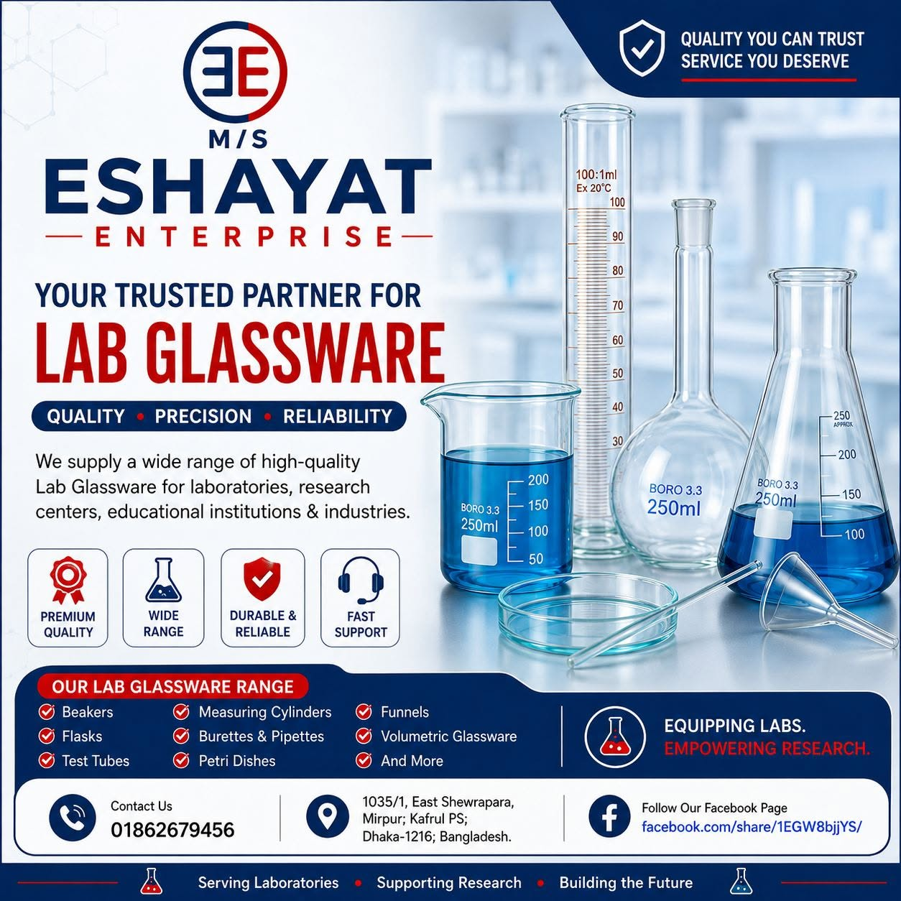

---

### Post / Item #12
- **Post/Media ID:** `122102860077425702`
- **Local Image(s):** [`images/posts/059_767268754_122102860083425702_7737061691694385381_n.jpg`](images/posts/059_767268754_122102860083425702_7737061691694385381_n.jpg)

```text
🧪 Premium Laboratory Reagent Bottles – Now Available!

Looking for reliable, durable, and high-quality reagent bottles for your laboratory? M/S Eshayat Enterprise is now offering premium laboratory reagent bottles suitable for a wide range of laboratory applications.

🔹 Available Sizes: 100ml | 250ml | 500ml | 800ml | 1000ml
🔹 High-quality laboratory glass
🔹 Chemical resistant
🔹 Autoclavable
🔹 Leak-proof screw cap
🔹 Clear graduation for easy measurement
🔹 Durable and suitable for long-term laboratory use

Perfect for laboratories, research institutions, pharmaceutical industries, educational institutes, hospitals, and quality control labs.

📍 M/S Eshayat Enterprise
1035/1, East Shewrapara, Mirpur; Kafrul PS, Dhaka-1216, Bangladesh
📞 01862679456

📩 Contact us for price, availability & bulk orders.

Equip Your Lab with the Best – Choose Eshayat Enterprise.

#EshayatEnterprise #ReagentBottle #LaboratoryGlassware #LabSupplies #LaboratoryEquipment #ScientificSupplies #GlassBottle #LabEquipment #Bangladesh
```

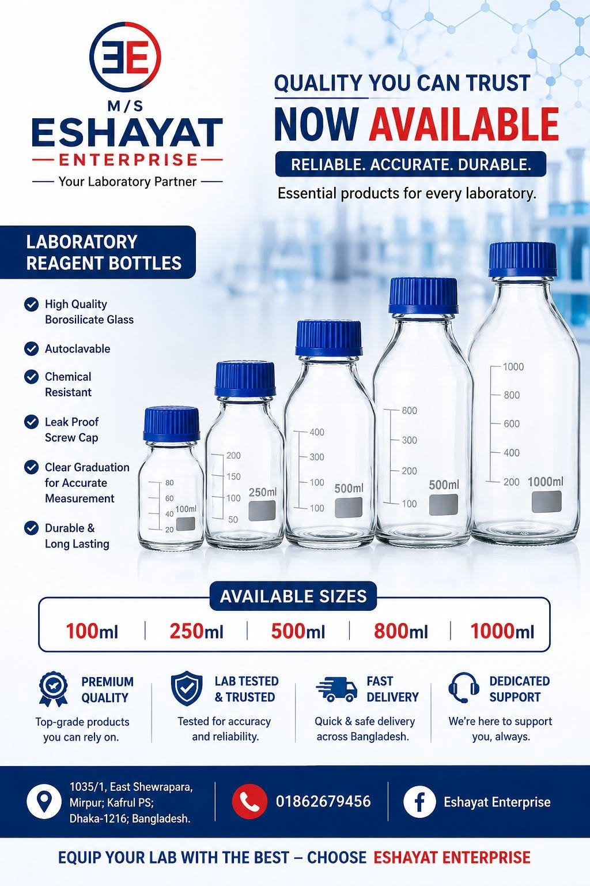

---

### Post / Item #13
- **Post/Media ID:** `122102861865425702`
- **Local Image(s):** [`images/posts/058_765929057_122102861871425702_934085831313873719_n.jpg`](images/posts/058_765929057_122102861871425702_934085831313873719_n.jpg)

```text
🔬 High-Precision Volumetric Pipettes Now Available!

Looking for reliable and accurate laboratory glassware? M/s. Eshayat Enterprise brings you Class A Volumetric Pipettes designed for precise laboratory measurements.

✅ Available Sizes: 5ml | 10ml | 20ml | 50ml
✅ Class A accuracy
✅ High-quality borosilicate glass
✅ Clear graduation for precise measurement
✅ Suitable for laboratory, research, QC & educational applications
✅ Reliable quality at competitive prices

📦 Available now at M/s. Eshayat Enterprise

📞 Contact: 01862679456
📍 Address: 1035/1, East Shewrapara, Mirpur, Kafrul PS, Dhaka-1216, Bangladesh.

📩 Contact us for price & availability.

#EshayatEnterprise #VolumetricPipette #LaboratoryGlassware #LabEquipment #ClassAPipette #BorosilicateGlass #LaboratorySupplies #LabGlassware #Bangladesh
```

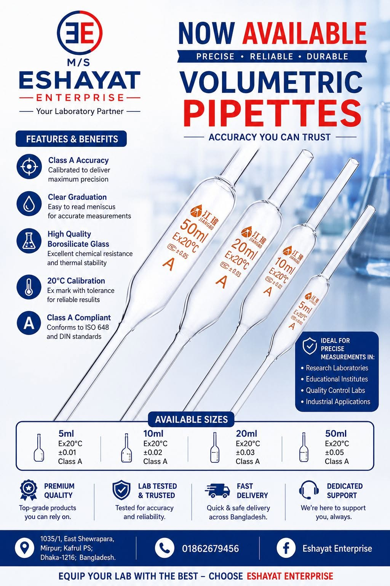

---

### Post / Item #14
- **Post/Media ID:** `122102867355425702`
- **Local Image(s):** [`images/posts/057_767031517_122102867361425702_7813253385069730448_n.jpg`](images/posts/057_767031517_122102867361425702_7813253385069730448_n.jpg)

```text
M/s. Eshayat Enterprise — Your Trusted Partner for Laboratory & Industrial Supplies! 🧪

Looking for reliable laboratory equipment, glassware, safety products, and industrial supplies? We are here to support your business with quality products and dependable service.

✅ Laboratory Glassware & Equipment
✅ Laboratory Consumables
✅ Safety & PPE Products
✅ Industrial Cleaning & Hygiene Products
✅ Quality Products at Competitive Prices
✅ Reliable Customer Support

Whether you are a laboratory, pharmaceutical company, hospital, educational institution, research organization, or industrial facility, we are ready to serve your requirements.

📦 Quality Products | Competitive Price | Reliable Service

📍 Address: 1035/1, East Shewrapara, Mirpur, Kafrul, Dhaka-1216, Bangladesh
📞 Contact: 01862679456

👉 Follow our Facebook page and stay updated with our latest products and offers!

#EshayatEnterprise #LaboratorySupplies #LabGlassware #LabEquipment #SafetyProducts #PPE #IndustrialSupplies #LaboratoryEquipment #Bangladesh #Dhaka
```

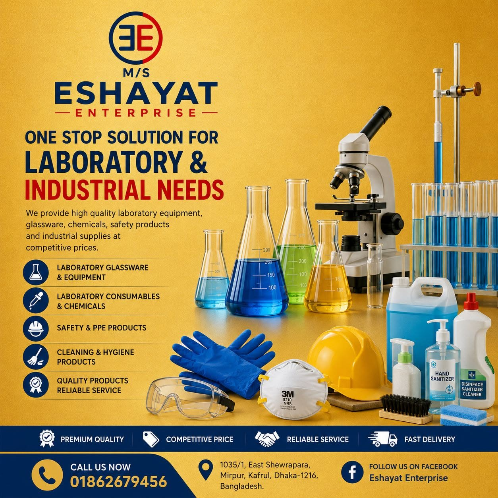

---

### Post / Item #15
- **Post/Media ID:** `122102914983425702`
- **Local Image(s):** [`images/posts/056_767400864_122102914989425702_5773990440345723970_n.jpg`](images/posts/056_767400864_122102914989425702_5773990440345723970_n.jpg)

```text
[Poster Text] M/S Eshayat Enterprise — Essential Tools for Every Laboratory:
1. SCHOTT DURAN Laboratory Bottle (250ml, Heat & Chemical Resistant, Autoclavable, Made in Germany)
2. Volumetric Pipettes (5ml | 10ml | 20ml | 50ml, Class A Accuracy, Borosilicate Glass)
3. Digital Caliper (150mm / 6", High Precision Measurement, Digital Display, Metric & Inch Conversion, Stainless Steel)
Contact: 01862679456 | 1035/1, East Shewrapara, Mirpur, Kafrul PS, Dhaka-1216, Bangladesh
```

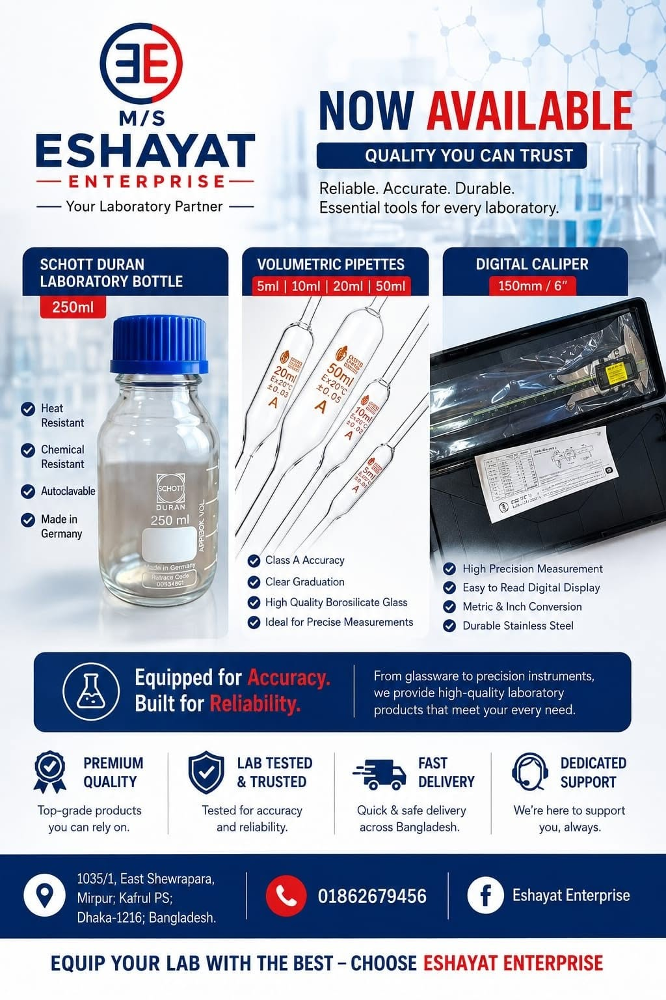

---

### Post / Item #16
- **Post/Media ID:** `122102927133425702`
- **Local Image(s):** [`images/posts/055_763847762_122102927139425702_4544511538496750510_n.jpg`](images/posts/055_763847762_122102927139425702_4544511538496750510_n.jpg)

```text
🛡️ Eshayat Enterprise — Your Trusted Partner for Safety, Quality & Efficiency
At M/s. Eshayat Enterprise, we provide reliable solutions for industries with a comprehensive range of:

🔹 Personal Protective Equipment (PPE)
🔹 Industrial Safety Equipment
🔹 Laboratory Glassware & Scientific Supplies
🔹 MRO (Maintenance, Repair & Operations) Products

From manufacturing, pharmaceuticals, power plants, oil & gas, construction, laboratories, educational institutions, and government sectors, we are committed to delivering quality products, competitive pricing, and dependable service.

🤝 Quality Products | Reliable Service | Your Trusted Partner

📍 1035/1, East Shewrapara, Mirpur, Dhaka-1216, Bangladesh
📞 01630200454 | 01862679456
📧 eshayat.enterprise@outlook.com

#EshayatEnterprise #IndustrialSafety #PPE #LaboratoryGlassware #MRO #SafetyEquipment #IndustrialSupplies #LabSupplies #WorkplaceSafety #Bangladesh #TrustedPartner
```

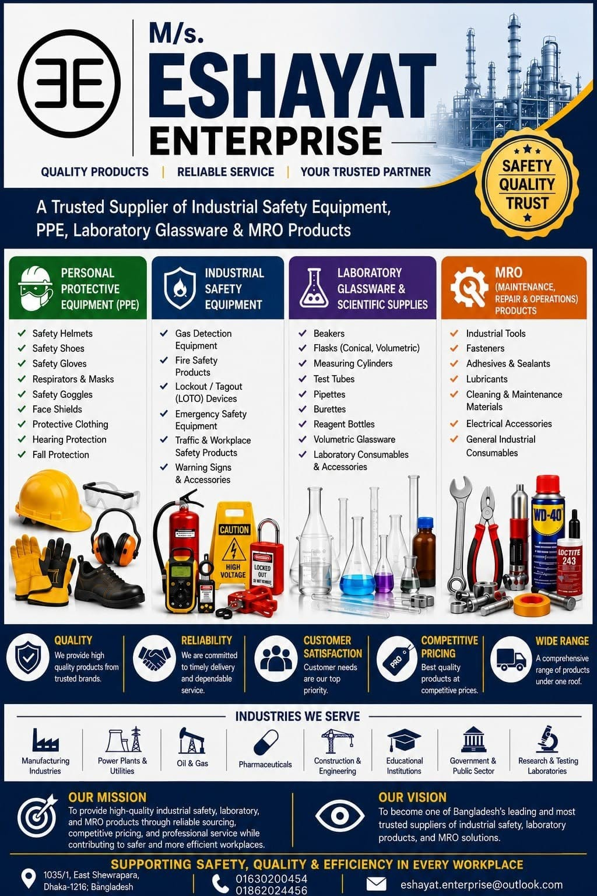

---

### Post / Item #17
- **Post/Media ID:** `122102971155425702`
- **Local Image(s):** [`images/posts/054_765731906_122102971161425702_6507415409110911177_n.jpg`](images/posts/054_765731906_122102971161425702_6507415409110911177_n.jpg)

```text
🔧 MRO PRODUCTS – KEEP YOUR BUSINESS RUNNING! ⚙️

Looking for reliable MRO (Maintenance, Repair & Operations) products for your factory, laboratory, office, or industrial facility?

M/s. Eshayat Enterprise is your trusted source for essential industrial & maintenance supplies.

🛠️ Our MRO Product Range Includes:
• Hand Tools & Power Tools
• Safety Products & PPE
• Fasteners & Hardware
• Lubricants & Maintenance Chemicals
• Electrical & Industrial Accessories
• Cleaning & Janitorial Supplies
• Adhesives, Tapes & Sealants
• Abrasives & Cutting Products
• Industrial Consumables
• General Maintenance Items

✅ Quality Products
✅ Competitive Price
✅ Reliable Supply
✅ Professional Service

One Supplier. Multiple MRO Solutions.

📍 1035/1, East Shewrapara, Mirpur, Kafrul PS, Dhaka-1216, Bangladesh
📞 01862679456

📩 Contact M/s. Eshayat Enterprise for your MRO requirements today!

#EshayatEnterprise #MROProducts #IndustrialSupplies #MaintenanceProducts #IndustrialProducts #SafetyProducts #FactorySupplies #Bangladesh
```

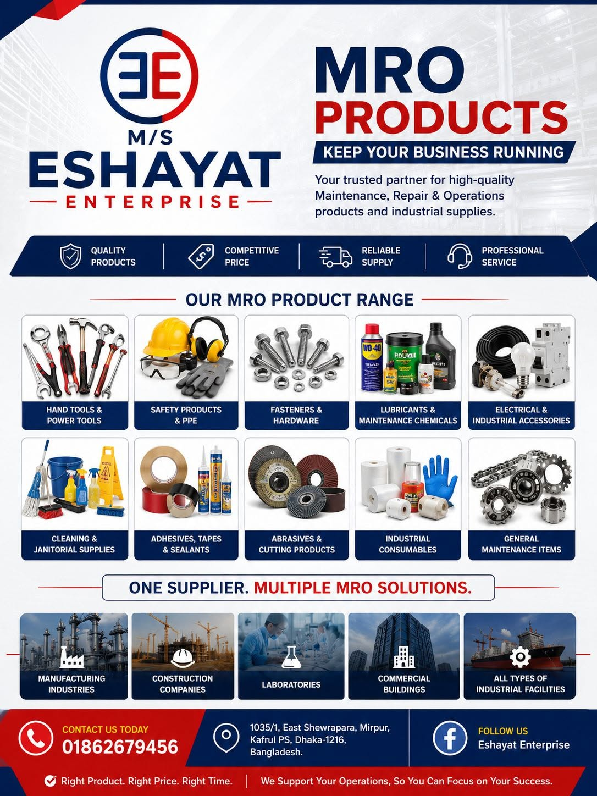

---

### Post / Item #18
- **Post/Media ID:** `122103787485425702`
- **Local Image(s):** [`images/posts/053_768205261_122103787491425702_8876626560385057973_n.jpg`](images/posts/053_768205261_122103787491425702_8876626560385057973_n.jpg)

```text
🔥 FIRE SAFETY STARTS WITH BEING PREPARED! 🧯🛡️

Protect your workplace, people & property with reliable Fire Protection & Safety Equipment from M/s. Eshayat Enterprise.

🚒 Our Fire Safety Range Includes:
✔️ Fire Blankets
✔️ Fire Cabinets
✔️ Fire Safety Helmets
✔️ Fire Safety Boots
✔️ Fire Sand Shovels
✔️ Bolt Cutters
✔️ Safety Tools & Equipment etc.

🏭 Ideal for: Factories • Offices • Warehouses • Construction Sites • Industrial Facilities

⚠️ DON’T WAIT FOR AN EMERGENCY — BE PREPARED TODAY!

📞 Call/Message us for product details, price & availability.
📦 Bulk & corporate orders welcome.

M/s. Eshayat Enterprise
📍 1035/1, East Shewrapara, Mirpur, Kafrul PS, Dhaka-1216
📱 01862-679456

🛡️ Your Safety, Our Priority.

#FireSafety #FireProtection #SafetyEquipment #WorkplaceSafety #IndustrialSafety #PPE #FireSafetyEquipment #EshayatEnterprise #SafetyFirst #BePrepared
```

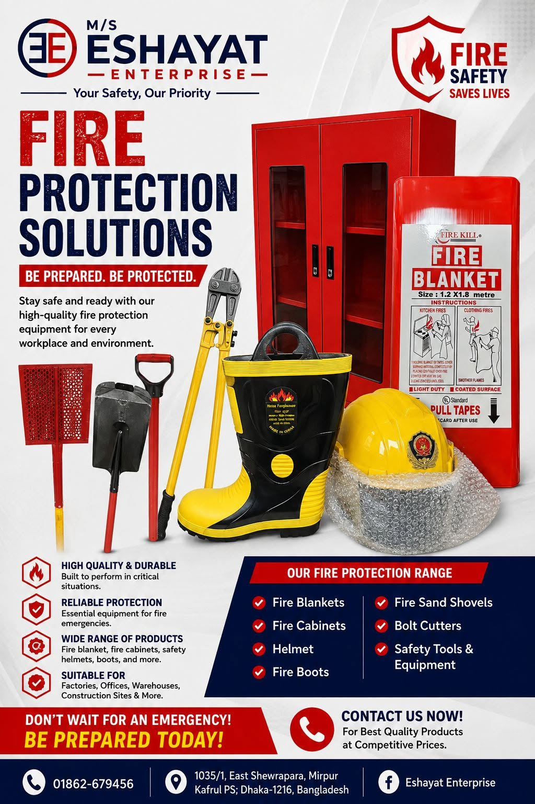

---

### Post / Item #19
- **Post/Media ID:** `122103908307425702`
- **Local Image(s):** [`images/posts/052_764845229_122103908313425702_6426610817239491136_n.jpg`](images/posts/052_764845229_122103908313425702_6426610817239491136_n.jpg)

```text
🧤 Industrial Hand Gloves Now Available!
Protect your hands with reliable, durable & comfortable industrial gloves—designed for demanding work environments.

✅ Chemical Protection
✅ Cut & Abrasion Resistance
✅ Heat & Cold Protection
✅ Better Grip & Handling
✅ Durable & Comfortable

🏭 Ideal for: Laboratory | Chemical Industry | Mechanical Work | Cleaning & Maintenance | Pharmaceutical & Research

📦 Available Now at M/s. Eshayat Enterprise
📞 01862679456

📍 1035/1, East Shewrapara, Mirpur, Kafrul PS, Dhaka-1216, Bangladesh.

📩 Contact us for price & availability.

#EshayatEnterprise #IndustrialGloves #SafetyGloves #ChemicalResistantGloves #HandProtection #IndustrialSafety #LaboratorySupplies #SafetyEquipment #Bangladesh
```

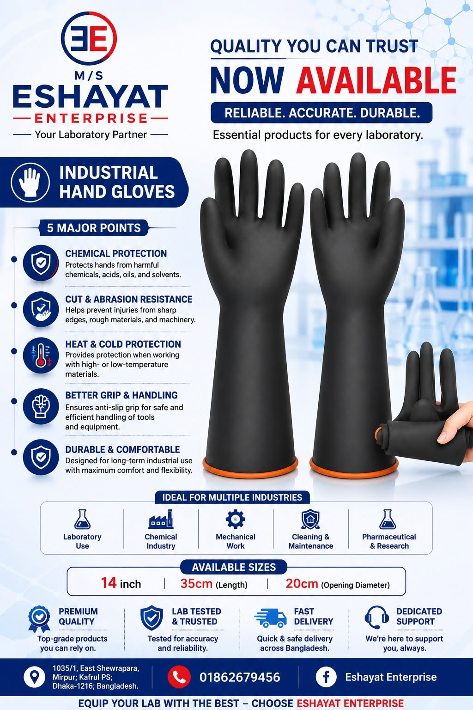

---

### Post / Item #20
- **Post/Media ID:** `122104325433425702`
- **Local Image(s):** [`images/posts/051_765964187_122104325445425702_8762610568190848786_n.jpg`](images/posts/051_765964187_122104325445425702_8762610568190848786_n.jpg)

```text
🥽 Safety Goggles Now Available!

Protect your eyes with reliable, durable & comfortable safety goggles—designed for effective eye protection in demanding work environments.

✅ Eye Protection from Dust & Debris
✅ Splash & Chemical Protection
✅ Impact & Scratch Resistance
✅ Clear & Wide Vision
✅ Comfortable & Durable Design

🏭 Ideal for:
Laboratory | Chemical Industry | Pharmaceutical | Mechanical Work | Construction | Cleaning & Maintenance | Research

📦 Available Now at M/s. Eshayat Enterprise

📞 01862679456

📍 1035/1, East Shewrapara, Mirpur, Kafrul PS, Dhaka-1216, Bangladesh

📩 Contact us for Price & Availability.

#EshayatEnterprise #SafetyGoggles #SafetyGlasses #EyeProtection #LaboratorySupplies #ChemicalSafety #IndustrialSafety #SafetyEquipment #Bangladesh
```

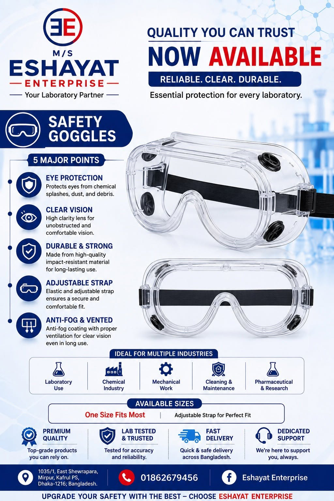

---

### Post / Item #21
- **Post/Media ID:** `122104914825425702`
- **Local Image(s):** [`images/posts/050_769469607_122104914831425702_7334514466337662976_n.jpg`](images/posts/050_769469607_122104914831425702_7334514466337662976_n.jpg)

```text
🥾 Industrial Safety Shoes Now Available!

Protect your feet with durable, comfortable & reliable Industrial Safety Shoes—designed for demanding work environments.

✅ Steel/Protective Toe Cap
✅ Anti-Slip Sole
✅ Puncture Protection
✅ Durable & Comfortable
✅ Suitable for Long Working Hours
✅ Designed for Industrial Work

🏭 Ideal for: Construction | Factory | Mechanical Work | Warehouse | Engineering | Chemical Industry | Maintenance

📦 Available Now at M/s. Eshayat Enterprise

🛡️ Safety Starts from the Ground Up!
```

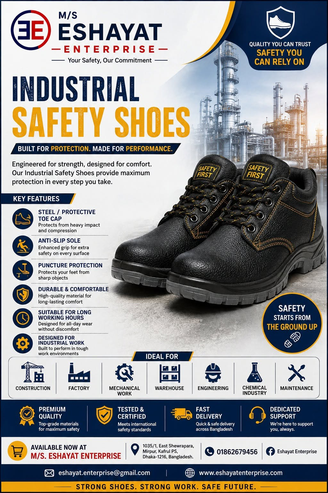

---

### Post / Item #22
- **Post/Media ID:** `122106501273425702`
- **Local Image(s):** [`images/posts/049_770688418_122106501279425702_9146525816119285848_n.jpg`](images/posts/049_770688418_122106501279425702_9146525816119285848_n.jpg)

```text
🔬 Precision You Can Trust with Eshayat Enterprise!
Looking for a reliable and accurate Micropipette for your laboratory? 🧪

Introducing QIUJING Adjustable Micropipette — designed for precise, comfortable and efficient liquid handling.

✅ Adjustable Volume
✅ Clear Digital Display
✅ Smooth & Easy Operation
✅ Durable & Reliable Design
✅ 20–200 µL range
✅ 2 Years Brand Warranty
✅ Ideal for laboratories, research & education

📞 Order Now: 01862 679456
📍 Eshayat Enterprise
1035/1, East Shewrapara, Mirpur, Kafrul PS, Dhaka-1216

Quality • Reliability • Trust 🇧🇩

#EshayatEnterprise #Micropipette #AdjustableMicropipette #LaboratoryEquipment #LabEquipment #LabSupplies #ResearchLab #LaboratorySupplies #Pipette #ScientificEquipment #Bangladesh #LabProfessionals
```

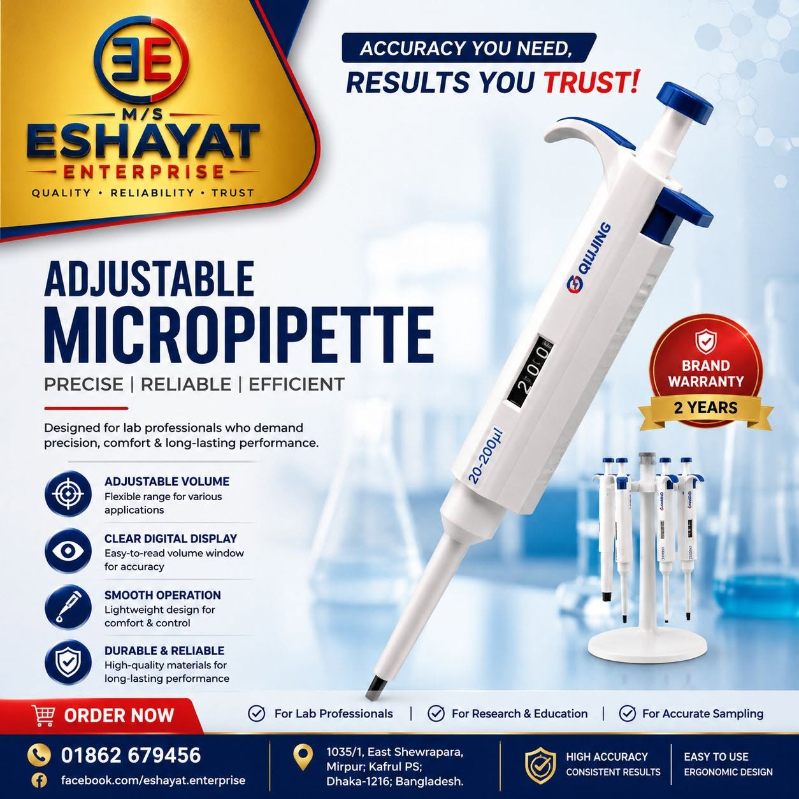

---

### Post / Item #23
- **Post/Media ID:** `122106521217425702`
- **Local Image(s):** [`images/posts/048_769682882_122106521223425702_6668308259017833321_n.jpg`](images/posts/048_769682882_122106521223425702_6668308259017833321_n.jpg)

```text
🔋 POWER THAT LASTS LONGER! ⚡

Introducing the SAFT LS 17500 – 3.6V Li-SOCl₂ Battery, a high-performance lithium battery designed for reliable, long-lasting power in critical applications.

✅ High Energy Density
✅ Long Shelf Life & Low Self-Discharge
✅ Wide Operating Temperature Range
✅ Stable & Reliable Performance
✅ Compact & Powerful

🔧 Ideal for:
• Metering & Smart Meters
• IoT Devices
• Memory Backup
• Security Systems
• Tracking Devices
• Industrial Applications

💡 Premium Power. Reliable Performance. Trusted Quality.

📍 M/S Eshayat Enterprise
1035/1, East Shewrapara, Mirpur; Kafrul PS; Dhaka-1216, Bangladesh
📞 +880 186 2679456
📧 eshayat.enterprise@outlook.com

📩 Contact us for price & availability.

#SAFT #LS17500 #LithiumBattery #LiSOCl2 #IndustrialBattery #IoT #SmartMeter #IndustrialSolutions #EshayatEnterprise #Bangladesh #BatterySolutions
```

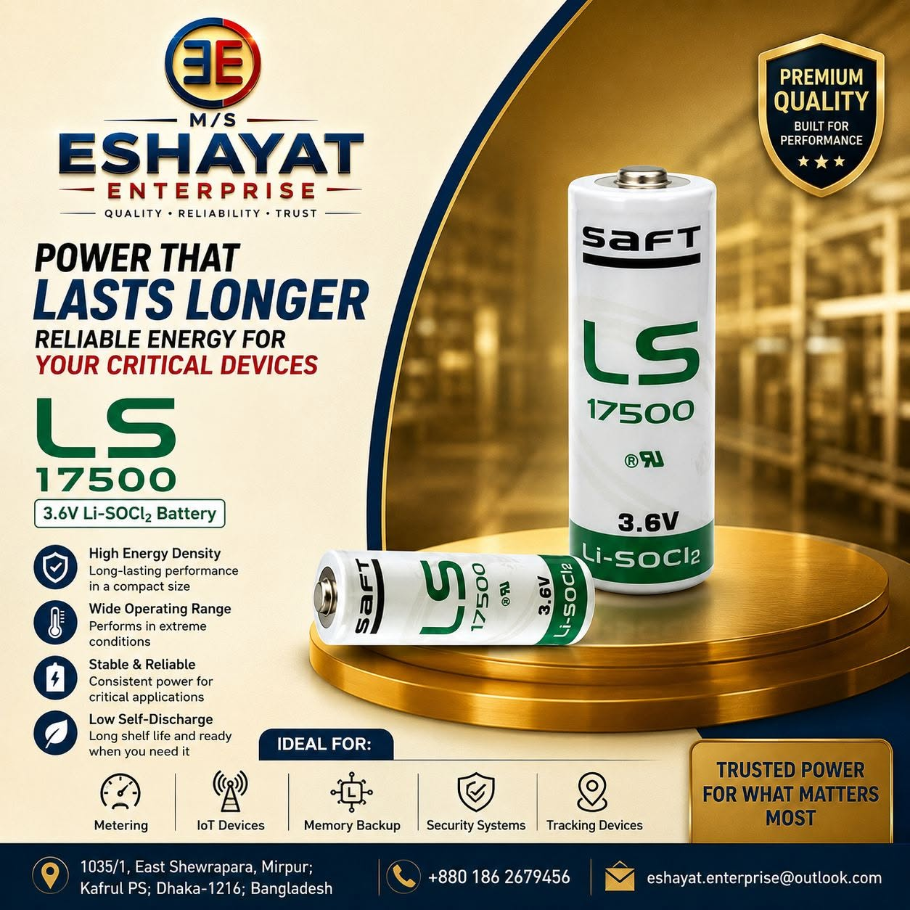

---

### Post / Item #24
- **Post/Media ID:** `122106548805425702`
- **Local Image(s):** [`images/posts/047_769804207_122106548811425702_9002164835740017584_n.jpg`](images/posts/047_769804207_122106548811425702_9002164835740017584_n.jpg)

```text
🚨 ENSURE SAFETY. SAVE LIVES. 🛡️

Protect your workforce with a reliable Emergency Shower & Eyewash Station — essential safety equipment for factories, laboratories, pharmaceutical plants, chemical industries, and other workplaces.

✅ Instant emergency shower for body decontamination
✅ Dual eyewash for quick eye rinsing
✅ Corrosion-resistant, industrial-grade construction
✅ Easy operation & maintenance
✅ Durable and reliable for demanding workplaces

🏭 Ideal for: Pharmaceutical | Chemical | Manufacturing | Laboratory | Industrial Facilities

📦 Order Now – Protect Your People. Protect Your Workplace.

📍 M/S Eshayat Enterprise
1035/1, East Shewrapara, Mirpur, Kafrul PS, Dhaka-1216
📞 +880 186 2679456
📧 eshayat.enterprise@outlook.com

#EshayatEnterprise #EmergencyShower #EyewashStation #IndustrialSafety #WorkplaceSafety #PPE #SafetyEquipment #PharmaceuticalIndustry #ChemicalIndustry #FactorySafety #Bangladesh
```

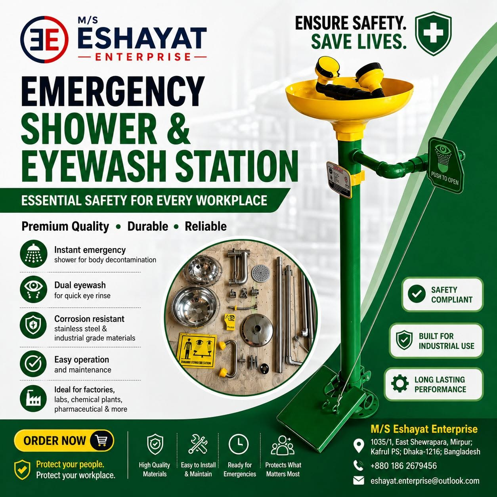

---

### Post / Item #25
- **Post/Media ID:** `122106741183425702`
- **Local Image(s):** [`images/posts/046_773290933_122106741195425702_3512240543947662223_n.jpg`](images/posts/046_773290933_122106741195425702_3512240543947662223_n.jpg)

```text
⚡ ELECTRICAL ISOLATION MAT — SAFETY YOU CAN STAND ON!

Protect your electrical work areas with high-quality Electrical Isolation Mats, designed for use around electrical panels and equipment.

🛡️ Key Features:
✔️ High Electrical Insulation
✔️ Anti-Slip Textured Surface
✔️ Durable & Flexible
✔️ Easy to Clean & Maintain
✔️ Ideal for Switch Rooms, Control Panels, Electrical Rooms, Substations & Power Plants

🏭 Suitable for:
Pharmaceutical | Manufacturing | Power & Utility | Industrial Facilities

📞 For Price & Availability: 01862 679456
📧 Email: eshayat.enterprise@outlook.com

M/s Eshayat Enterprise
Your Trusted Partner for Quality & Safety

#ElectricalSafety #ElectricalIsolationMat #SafetyMat #IndustrialSafety #ElectricalSafetyProducts #PPE #IndustrialSafety #MRO #EshayatEnterprise #Bangladesh
```

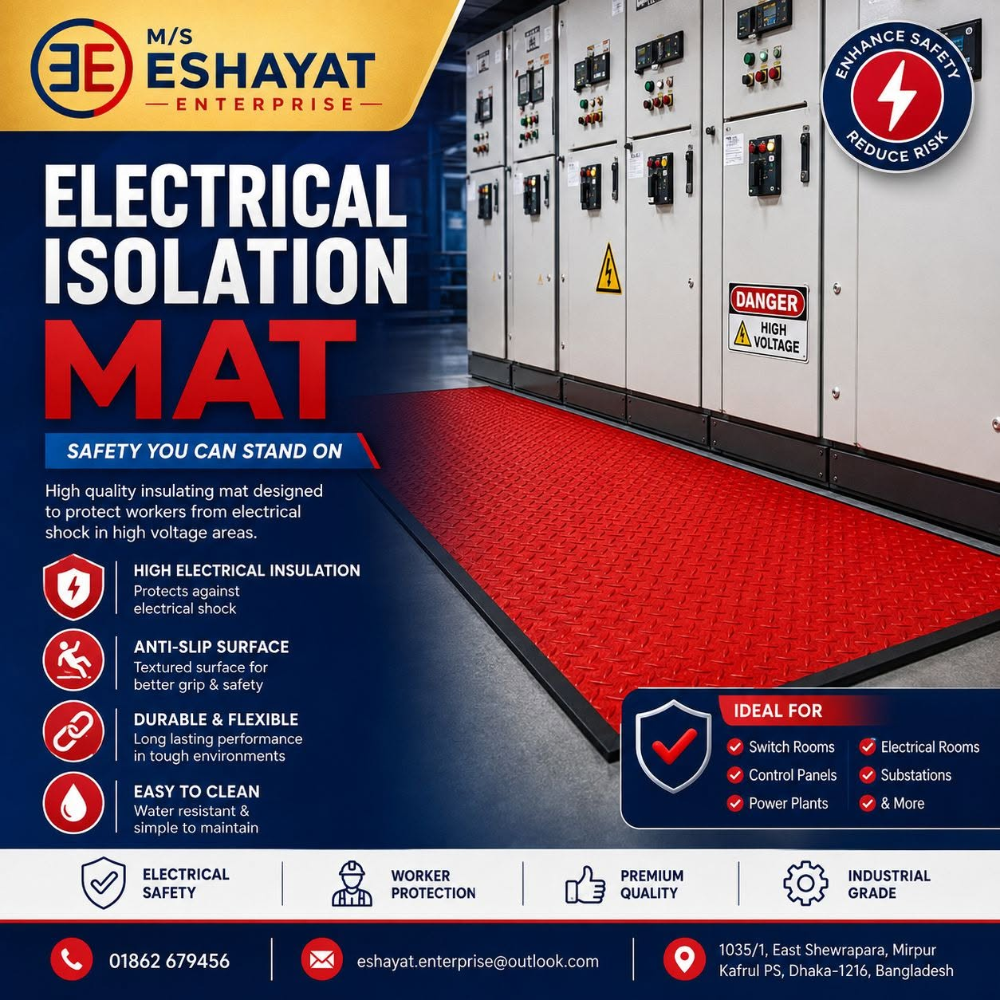

---

### Post / Item #26
- **Post/Media ID:** `122107307439425702`
- **Local Image(s):** [`images/posts/045_773378985_122107307445425702_4734768745721468133_n.jpg`](images/posts/045_773378985_122107307445425702_4734768745721468133_n.jpg)

```text
🦺 BE SEEN. BE SAFE. 🦺

Protect your team with our High Visibility Safety Vest — designed to keep workers clearly visible in busy, low-light and high-risk environments.

✨ Key Features:
✅ High-visibility fluorescent fabric
✅ Reflective stripes for enhanced visibility
✅ Lightweight & comfortable
✅ Durable stitching and quality zipper
✅ Suitable for construction, traffic control, warehouse, security & outdoor work

🟠 Available in Orange
🟡 Available in Yellow

👷 Ideal for: Construction Teams | Traffic Control | Factory & Warehouse | Security | Event Staff | Outdoor Workers

🛡️ Your Safety, Our Priority.

📞 Order Now: 01862-679456
📍 1035/1, East Shewrapara, Mirpur, Kafrul PS, Dhaka-1216, Bangladesh
📘 Facebook: facebook.com/eshayat.enterprise

#EshayatEnterprise #SafetyVest #HighVisibilityVest #SafetyFirst #WorkplaceSafety #ReflectiveVest #ConstructionSafety #PPE #IndustrialSafety #WorkerSafety
```

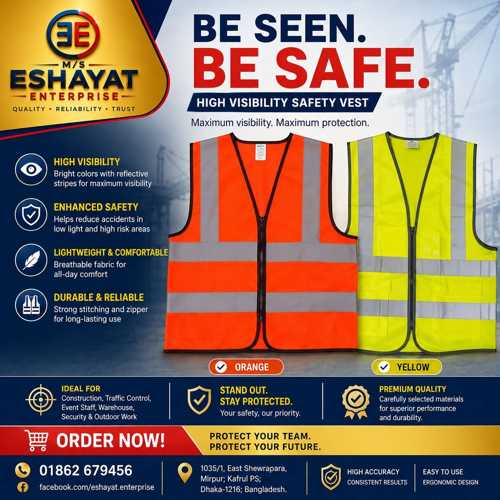

---

### Post / Item #27
- **Post/Media ID:** `122107818825425702`
- **Local Image(s):** [`images/posts/044_772663902_122107818831425702_7960579292510604450_n.jpg`](images/posts/044_772663902_122107818831425702_7960579292510604450_n.jpg)

```text
🦺 YOUR SAFETY, OUR PRIORITY! 🛡️

Complete safety solutions for construction, industry & workplace.

⛑️ Helmet | 🦺 Vest | Harness | 🧤 Gloves | 👢 Safety Shoes

Stay Protected. Work with Confidence.

📞 +880 186 2679456
📧 eshayat.enterprise@outlook.com

#EshayatEnterprise #SafetyFirst #PPE #WorkplaceSafety #IndustrialSafety #ConstructionSafety
```

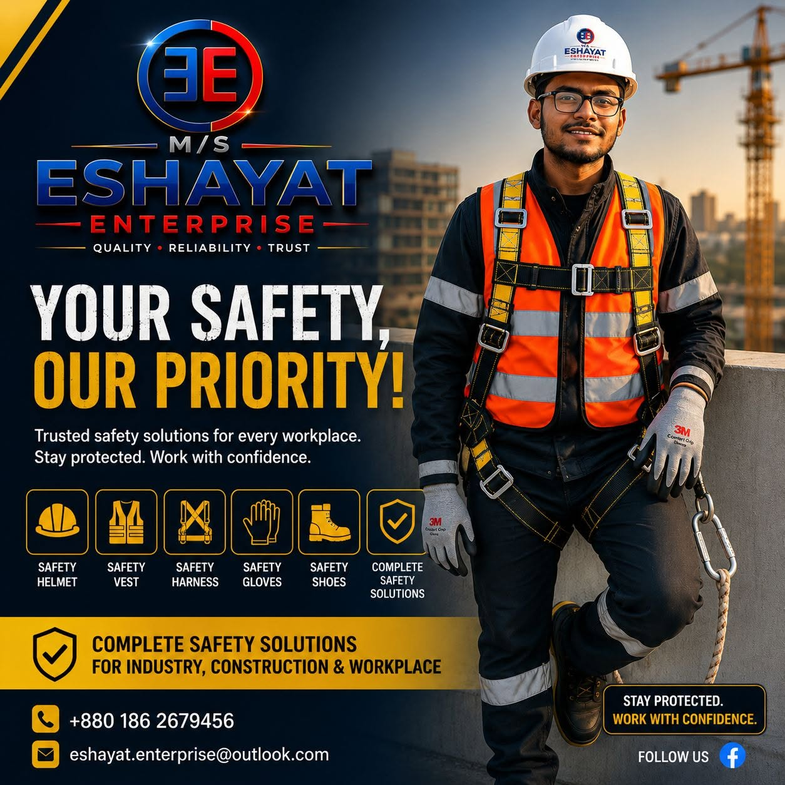

---

### Post / Item #28
- **Post/Media ID:** `122107830837425702`
- **Local Image(s):** [`images/posts/043_773735969_122107830843425702_5791137163405808914_n.jpg`](images/posts/043_773735969_122107830843425702_5791137163405808914_n.jpg)

```text
🪖 Premium Safety Helmets Now Available!
Protect your workforce with strong, durable & comfortable safety helmets—designed for maximum head protection in demanding work environments.

✅ High Impact Resistance
✅ Adjustable & Comfortable Fit
✅ Ventilated Design
✅ Lightweight & Durable
✅ UV Resistant
✅ Comfortable Suspension

🏗️ Ideal for: Construction | Factory | Engineering | Warehouse | Oil & Gas | Maintenance | Electrical | Industrial Sites

📦 Available at M/s. Eshayat Enterprise
📞 01862679456
📍 1035/1, East Shewrapara, Mirpur, Kafrul PS, Dhaka-1216
🛡️ Upgrade Your Safety With the Best – Choose Eshayat Enterprise
```

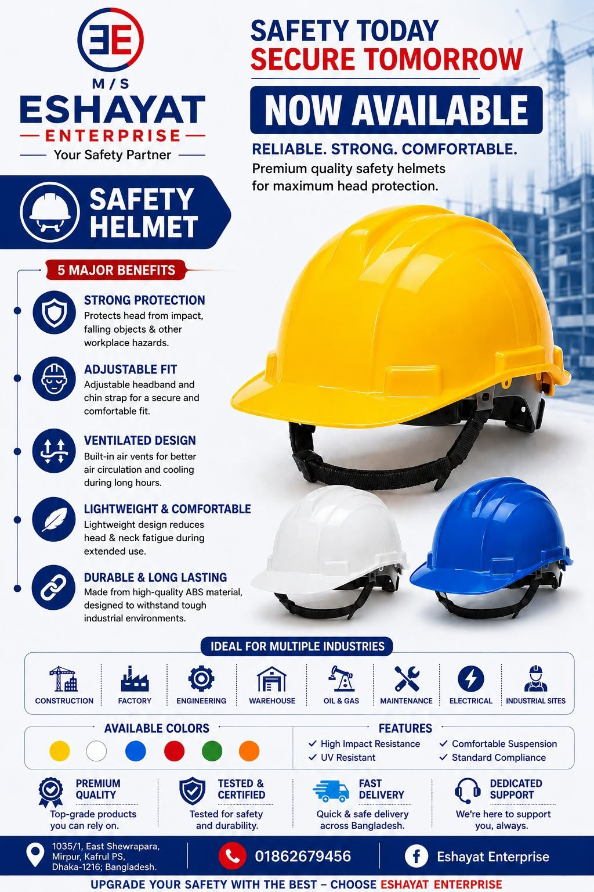

---

### Post / Item #29
- **Post/Media ID:** `122107838133425702`
- **Local Image(s):** [`images/posts/042_774362898_122107838139425702_8909640940007441229_n.jpg`](images/posts/042_774362898_122107838139425702_8909640940007441229_n.jpg)

```text
🎧 Industrial Ear Muffs Now Available!

Protect your hearing in high-noise work environments with durable, comfortable ear muffs designed for effective noise reduction and long-term use.

✅ Effective Noise Reduction
✅ Comfortable Padded Ear Cups
✅ Adjustable Headband
✅ Durable & Lightweight Design
✅ Secure & Comfortable Fit
✅ Ideal for Extended Use

🏭 Ideal for: Construction | Factory | Engineering | Manufacturing | Welding | Workshop | Power Plant | Industrial Sites

📦 Available at M/s. Eshayat Enterprise
📞 01862679456
📍 1035/1, East Shewrapara, Mirpur, Kafrul PS, Dhaka-1216

🛡️ Protect Your Hearing. Work Safely. Choose Eshayat Enterprise.
```

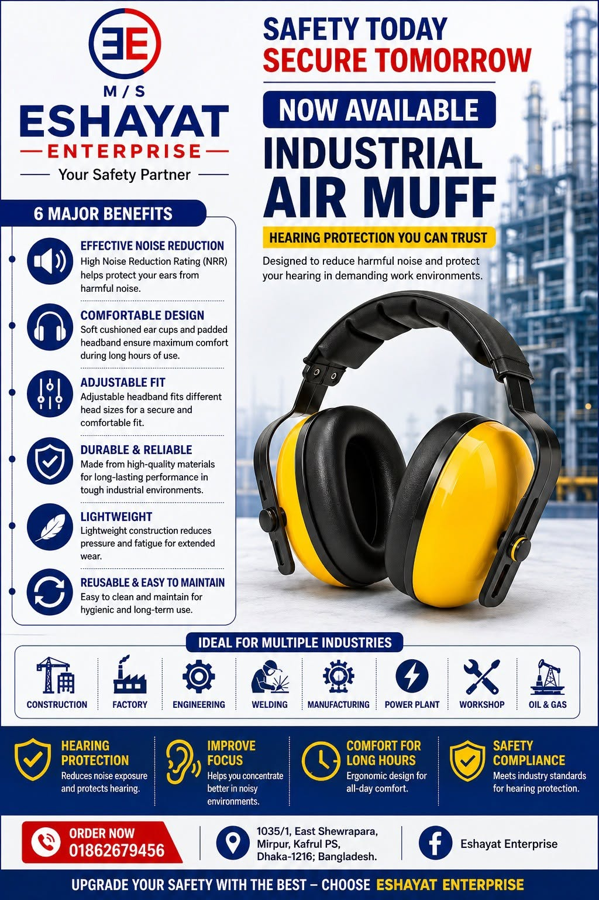

---

### Post / Item #30
- **Post/Media ID:** `122107840365425702`
- **Local Image(s):** [`images/posts/041_773696034_122107840371425702_7494103638884272011_n.jpg`](images/posts/041_773696034_122107840371425702_7494103638884272011_n.jpg)

```text
🦺 Safety Harness Now Available!

Stay protected while working at height with a strong, reliable & comfortable full-body safety harness designed for demanding industrial environments.

✅ Full-Body Protection
✅ Strong & Durable Webbing
✅ Adjustable & Comfortable Fit
✅ Secure D-Ring & Lanyard Connections
✅ Shock-Absorbing Lanyard
✅ Tested for Strength & Reliability

🏗️ Ideal for: Construction | Factory | Engineering | Electrical | Oil & Gas | Maintenance | Telecom | Work at Height

📦 Available at M/s. Eshayat Enterprise
📞 01862679456
📍 1035/1, East Shewrapara, Mirpur, Kafrul PS, Dhaka-1216

🛡️ Your Safety. Your Life. Our Priority.
```

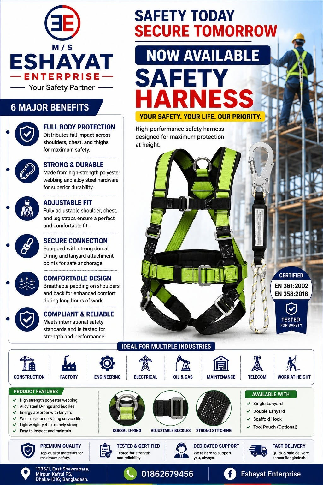

---

### Post / Item #31
- **Post/Media ID:** `122108177151425702`
- **Local Image(s):** [`images/posts/040_774471014_122108177157425702_5430375913466832514_n.jpg`](images/posts/040_774471014_122108177157425702_5430375913466832514_n.jpg)

```text
🔬 Precision You Can Trust — Volumetric Pipettes Now Available!

M/s. Eshayat Enterprise brings you Class A Volumetric Pipettes made from high-quality borosilicate glass, designed for accurate and reliable liquid measurement.

✅ Class A Accuracy
✅ High-Quality Borosilicate Glass
✅ Clear & Permanent Graduation
✅ TD (To Deliver) Calibration
✅ Available Sizes: 5 mL | 10 mL | 20 mL | 25 mL | 50 mL
🏭 Ideal for: Laboratory | Research | Quality Control | Pharmaceutical | Chemical Industry | Educational Institutions

📞 Contact: 01309816266
📍 Address: 1305/1 East Shewrapara, Mirpur; Kafrul PS; Dhaka–1216

M/s. Eshayat Enterprise — Precision in Every Drop, Trust in Every Result.
```

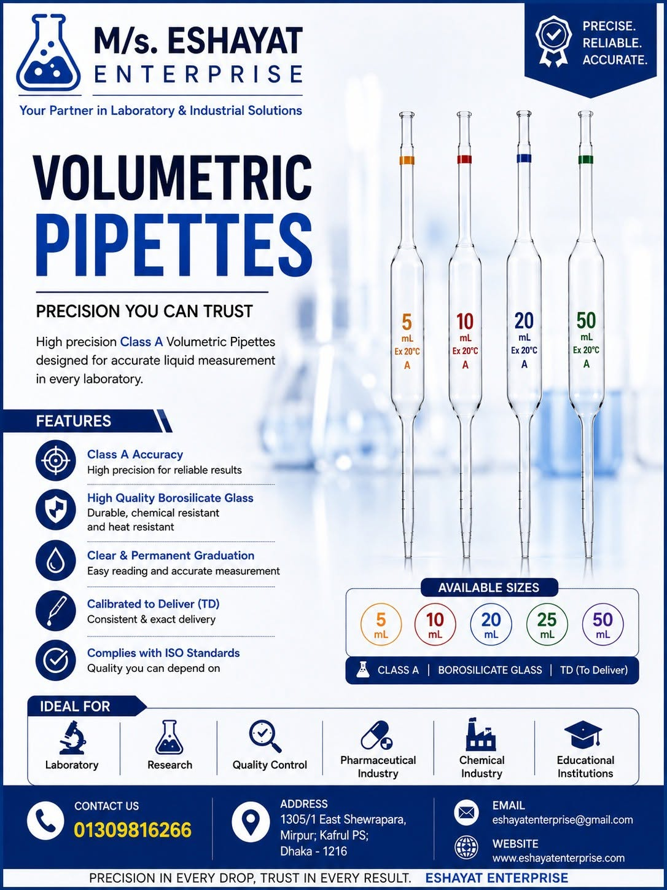

---

### Post / Item #32
- **Post/Media ID:** `122108178159425702`
- **Local Image(s):** [`images/posts/039_774401601_122108178165425702_1504140024038493460_n.jpg`](images/posts/039_774401601_122108178165425702_1504140024038493460_n.jpg)

```text
🔬 Premium Lab Glassware Now Available!

Reliable laboratory glassware for accurate measurement, safe handling & dependable results—ideal for laboratories, research, QC, pharmaceutical and chemical industries.

✅ High-Quality Glassware
✅ Accurate & Reliable
✅ Durable & Chemical Resistant
✅ Wide Range of Laboratory Products
✅ Suitable for Research & Industrial Applications

📞 Contact: 01309816266
📍 Address: 1305/1 East Shewrapara, Mirpur; Kafrul PS; Dhaka–1216

M/s. Eshayat Enterprise — Your Partner in Laboratory & Industrial Solutions.
```

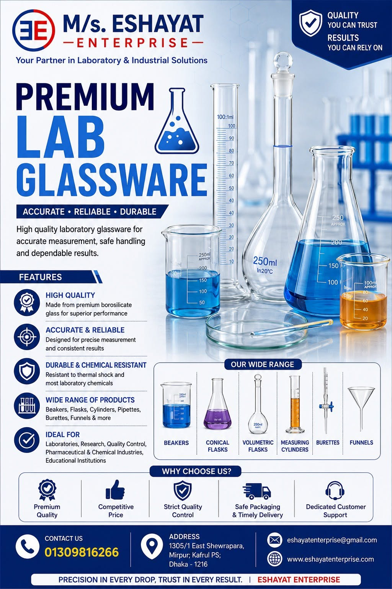

---

### Post / Item #33
- **Post/Media ID:** `122108179605425702`
- **Local Image(s):** [`images/posts/038_774281618_122108179617425702_1402537961128169562_n.jpg`](images/posts/038_774281618_122108179617425702_1402537961128169562_n.jpg)

```text
🧪 Laboratory Reagent Bottles Now Available!

Safely store and handle your laboratory chemicals with high-quality Reagent Bottles designed for reliable performance, durability and secure storage.

✅ High-Quality Glass
✅ Chemical Resistant
✅ Airtight & Leak-Proof
✅ Clear Graduation & Label Area
✅ Autoclavable & Reusable
✅ Available Sizes: 30 mL | 60 mL | 100 mL | 250 mL | 500 mL | 1000 mL | 2000 mL
🟤 Amber & ⚪ Clear options available

🏭 Ideal for: Laboratories | Research & Development | Quality Control | Pharmaceutical | Chemical Industry | Educational Institutions

📞 Contact: 01309816266
📍 Address: 1305/1 East Shewrapara, Mirpur; Kafrul PS; Dhaka–1216

M/s. Eshayat Enterprise — Store Safely. Work Accurately.
```

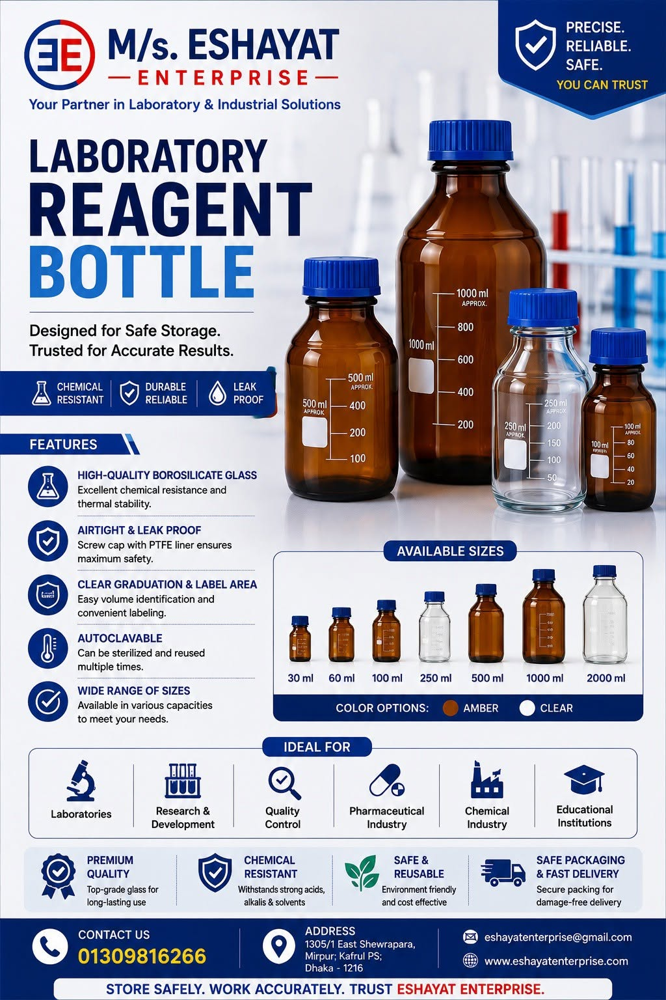

---

### Post / Item #34
- **Post/Media ID:** `122108768025425702`
- **Local Image(s):** [`images/posts/037_774512661_122108768031425702_318313289827620114_n.jpg`](images/posts/037_774512661_122108768031425702_318313289827620114_n.jpg)

```text
🔥 PROTECT YOUR EYES. WORK WITH CONFIDENCE! 👓🛡️

✨ 1710IN Protective Eyewear ✨

Your eyes deserve the best protection — now available at an EXCLUSIVE SPECIAL PRICE! 🎯

💥 SPECIAL OFFER: ONLY BDT 550.00/PC
⏳ Limited Time Offer — While Stocks Last!

✅ Reliable eye protection
✅ Lightweight & comfortable
✅ Clear vision for everyday work
✅ Ideal for industrial & workplace safety
✅ Professional quality you can trust

🚨 Don’t wait! Grab this special offer today.

📩 Inbox us now for order & details.
📦 Bulk orders are welcome!

🛡️ Safety First. Protection Always.

#EshayatEnterprise #SafetyEyewear #EyeProtection #PPE #IndustrialSafety #WorkplaceSafety #SafetyFirst #ProtectiveEyewear #SpecialOffer #LimitedTimeOffer #Bangladesh
```

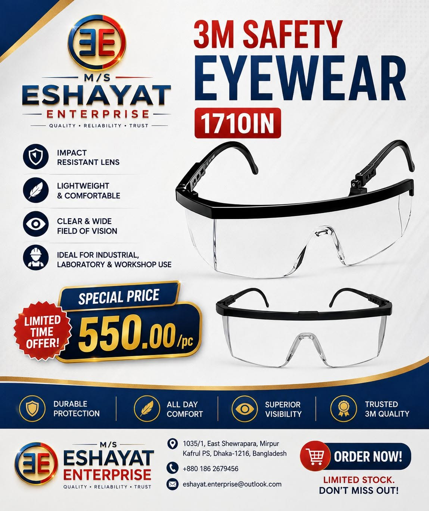

---

### Post / Item #35
- **Post/Media ID:** `122108961879425702`
- **Local Image(s):** [`images/posts/036_774600060_122108961891425702_6829040982120957405_n.jpg`](images/posts/036_774600060_122108961891425702_6829040982120957405_n.jpg)

```text
🇧🇩🏏 WHAT A VICTORY! 🎉🔥

Congratulations to the Bangladesh Cricket Team on a historic Test victory against Australia! 💚❤️

What a proud moment for the nation! Your passion, fighting spirit, and determination have made us all proud. 🇧🇩

Well played, Tigers! 🐅🏏
You made Bangladesh proud! ❤️

#BangladeshCricket #Tigers #Victory #ProudMoment #Bangladesh #Cricket
#EshayatEnterprise
```


---

### Post / Item #36
- **Post/Media ID:** `122109812535425702`
- **Local Image(s):** [`images/posts/035_778958002_122109812541425702_888001409578910223_n.jpg`](images/posts/035_778958002_122109812541425702_888001409578910223_n.jpg)

```text
🧯 FIRE EXTINGUISHER — STAY SAFE, STAY PREPARED! 🔥

Protect your workplace, property & people with reliable fire extinguishers.

✅ Effective Fire Protection
✅ Easy to Operate
✅ Durable & Reliable
✅ Suitable for Office, Factory & Warehouse
✅ Essential Emergency Safety Equipment

🏢 Available at M/s. Eshayat Enterprise

📞 Contact: 01862-679456
📍 Address: 1305/1 East Shewrapara, Mirpur; Kafrul PS; Dhaka - 1216

🛡️ Safety First. Protection Always.
```

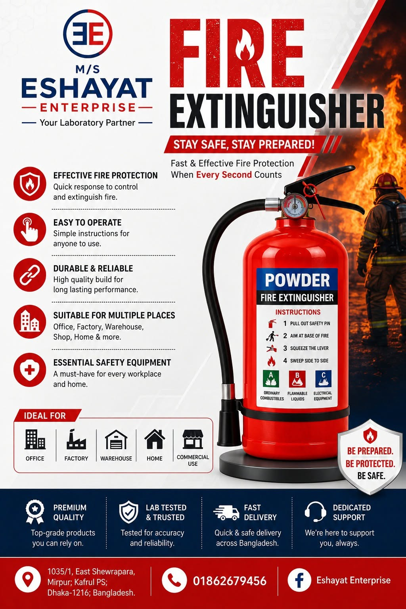

---

### Post / Item #37
- **Post/Media ID:** `122109814887425702`
- **Local Image(s):** [`images/posts/034_775376341_122109814899425702_3405502941721182220_n.jpg`](images/posts/034_775376341_122109814899425702_3405502941721182220_n.jpg)

```text
🦺 PROTECT YOUR TEAM. PROTECT YOUR WORK. 🛡️

Workplace safety isn’t optional—it’s essential. M/s. Eshayat Enterprise brings you a complete range of reliable safety equipment designed to help protect your people in demanding work environments.

🔹 Safety Helmet
🔹 Safety Goggles
🔹 Industrial Hand Gloves
🔹 Safety Shoe
🔹 Industrial Gas Mask
🔹 Ear Muff
🔹 Safety Harness
🔹 Fire Extinguisher

✅ Quality Products • Reliable Protection • Professional Support

🏭 Ideal for: Laboratory | Chemical Industry | Factory | Warehouse | Construction | Maintenance

📞 01862-679456
📍 1305/1 East Shewrapara, Mirpur; Kafrul PS; Dhaka-1216

M/s. Eshayat Enterprise — Your Safety, Our Priority. 🔰
```

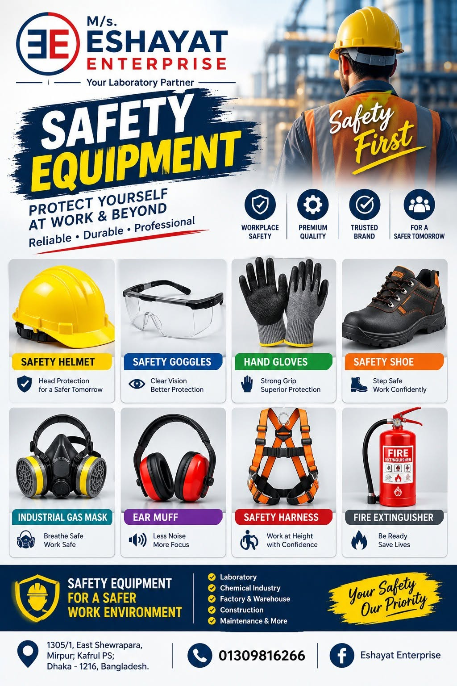

---

### Post / Item #38
- **Post/Media ID:** `122109821721425702`
- **Local Image(s):** [`images/posts/033_778915752_122109821727425702_1779593985979875025_n.jpg`](images/posts/033_778915752_122109821727425702_1779593985979875025_n.jpg)

```text
🧪 LAB ACCESSORIES | QUALITY YOU CAN RELY ON

Equip your laboratory with dependable products designed for precision, performance & safety.

🔬 Our Product Range:
• Laboratory Glassware
• Pipettes & Burettes
• Measuring & Weighing Instruments
• Support & Heating Equipment
• Safety Accessories
• Storage & Handling Products
• Cleaning Accessories

🏭 Perfect for: Laboratories | Research | Pharmaceuticals | Chemical Industries | QC | Educational Institutions & More

✨ Quality Products • Professional Service • Reliable Solutions

📍 1305/1, East Shewrapara, Mirpur, Kafrul PS, Dhaka–1216
📞 01309816266

M/s. ESHAYAT ENTERPRISE
Your Laboratory Partner

#EshayatEnterprise #LabAccessories #LaboratorySupplies #LabEquipment #LaboratoryGlassware #LabSolutions #ScientificEquipment #QualityLaboratoryProducts
```

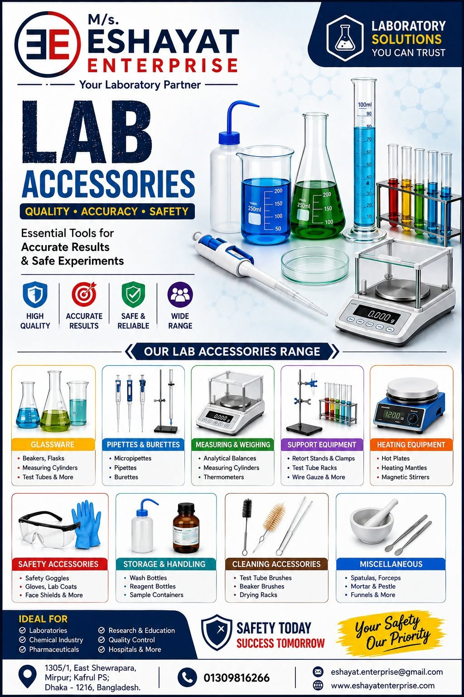

---

### Post / Item #39
- **Post/Media ID:** `122110584291425702`
- **Local Image(s):** [`images/posts/032_781979662_122110584297425702_8224180594941420413_n.jpg`](images/posts/032_781979662_122110584297425702_8224180594941420413_n.jpg)

```text
🛡️ PREMIUM RESPIRATORY PROTECTION – BREATHE SAFE, WORK SAFE!

Protect yourself with reliable Respiratory Filters designed for demanding industrial, chemical, construction, laboratory & other hazardous environments.

✅ CE Certified
✅ EN 140:1998 Compliant
✅ High-Efficiency Filtration
✅ Comfortable & Lightweight
✅ Reliable Protection for Harsh Environments

🔹 Available Filters:
• Gas & Vapour Filter – Organic/Acid Gases
• Combined Filter – Gas, Vapour & Particulates
• Particulate Filter – Dust, Fume & Mist
• Pre-Filter – For Extended Use

💡 Get the Right Filter. Get Maximum Protection.

📞 Order Now: 01862-679456 
📧 eshayat.enterprise@outlook.com
📍 M/s Eshayat Enterprise
Quality • Reliability • Trust

#RespiratoryProtection #RespiratoryFilter #SafetyEquipment #PPE #CESafety #EN140 #IndustrialSafety #WorkplaceSafety #EshayatEnterprise
```

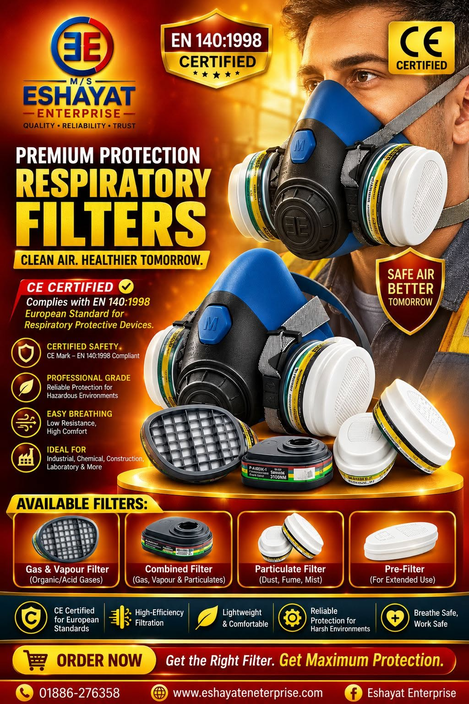

---

### Post / Item #40
- **Post/Media ID:** `122110585437425702`
- **Local Image(s):** [`images/posts/031_782492697_122110585443425702_4503993509866040597_n.jpg`](images/posts/031_782492697_122110585443425702_4503993509866040597_n.jpg)

```text
[Poster Text] M/S Eshayat Enterprise — REUSABLE HALF FACE RESPIRATOR MASK (EN 140:1998 Certified)
• Premium Protection (Filters dust, fumes & harmful particles) • Comfortable Ergonomic Design • Reusable & Durable • Adjustable Straps
Ideal For: Construction | Painting | Industrial | Laboratory | Daily Use
Contact: 01886-276358 | www.eshayatenterprise.com
```

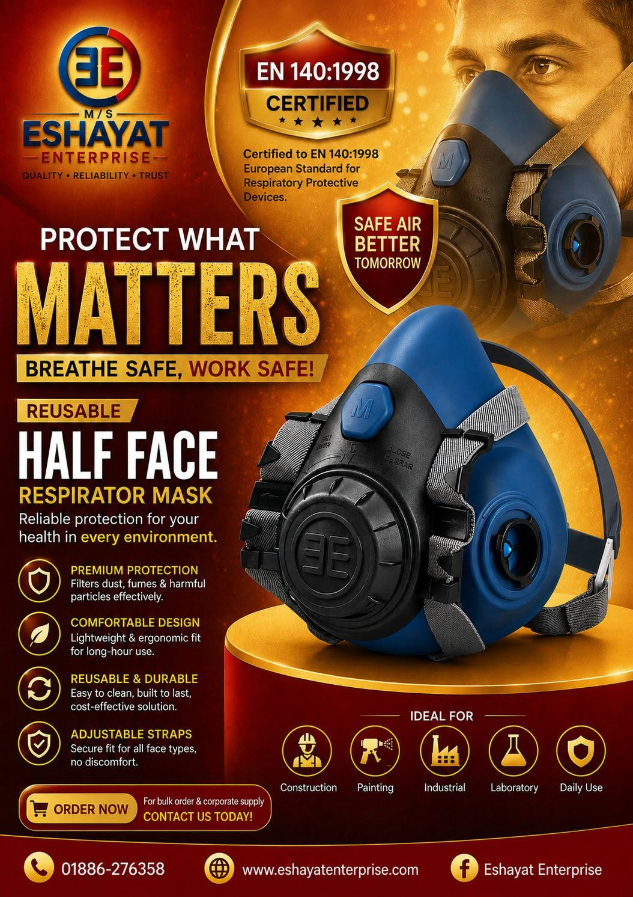

---

### Post / Item #41
- **Post/Media ID:** `122111535339425702`
- **Local Image(s):** [`images/posts/030_786354102_122111535345425702_8767300005562407966_n.jpg`](images/posts/030_786354102_122111535345425702_8767300005562407966_n.jpg)

```text
🔥 DON’T WAIT FOR A FIRE TO THINK ABOUT SAFETY. 🧯
Protect your people, property & workplace with reliable Fire Safety Equipment from M/s. Eshayat Enterprise.
🛡️ Complete Fire Protection Solutions:
🧯 Fire Extinguishers | 🚨 Fire Alarms & Smoke Detectors
🧑‍🚒 Fire Fighting Suits & Helmets | 🧤 Protective Gloves & Boots
🔥 Fire Blankets | 🚒 Hose & Hose Reels | 💧 Hydrant Systems
💡 Emergency Lights | 🚪 Fire Exit Signs | 🪓 Fire Axes & Escape Ladders
✅ Quality Products
✅ Reliable Performance
✅ Suitable for Industrial & Commercial Use
✅ Corporate & Bulk Supply Available
BE PREPARED. STAY SAFE.
📞 01309816266
🌐 eshayatenterprise.com
📍 M/s. Eshayat Enterprise — Importer, Supplier & Whole Seller of Laboratory, Industrial Safety & Technical Equipment
#FireSafety #FireProtection #SafetyFirst #FireSafetyEquipment #IndustrialSafety #WorkplaceSafety #EshayatEnterprise
```

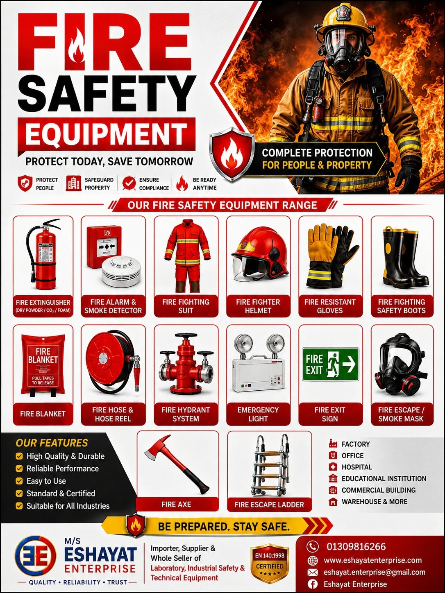

---

### Post / Item #42
- **Post/Media ID:** `122111536977425702`
- **Local Image(s):** [`images/posts/029_784843357_122111536983425702_1996215650163768893_n.jpg`](images/posts/029_784843357_122111536983425702_1996215650163768893_n.jpg)

```text
🦺 YOUR SAFETY STARTS WITH THE RIGHT PPE. 🛡️
Every workplace has risks—but the right Personal Protective Equipment (PPE) can help protect what matters most: your people.
At M/s. Eshayat Enterprise, we provide reliable PPE solutions designed for demanding industrial, laboratory, construction and commercial environments.
🔰 Our PPE Range Includes:
🪖 Safety Helmets
🥽 Safety Goggles & Face Shields
😷 Respirators & Protective Masks
🧤 Safety Gloves
👢 Safety Shoes & Boots
🦺 Reflective Safety Vests
🎧 Ear Plugs & Ear Muffs
🪢 Full Body Safety Harness
👔 Protective & Chemical-Resistant Clothing
🔥 Fire Fighting PPE
✅ PROTECT YOUR TEAM
✅ REDUCE WORKPLACE RISKS
✅ BUILD A SAFER WORKPLACE
🏭 Ideal For:
Industrial • Construction • Laboratory • Chemical • Pharmaceutical • Factory • Warehouse
SAFETY ISN'T EXPENSIVE — IT'S PRICELESS.
🛡️ USE PPE. WORK SAFE. GO HOME SAFE.
📞 Call Us: 01309816266
🌐 eshayatenterprise.com⁠�
M/s. ESHAYAT ENTERPRISE
Your Trusted Partner for Laboratory, Industrial Safety & Technical Equipment.
#PPE #SafetyFirst #IndustrialSafety #WorkplaceSafety #PersonalProtectiveEquipment #SafetyEquipment #WorkSafe #GoHomeSafe #EshayatEnterprise
```

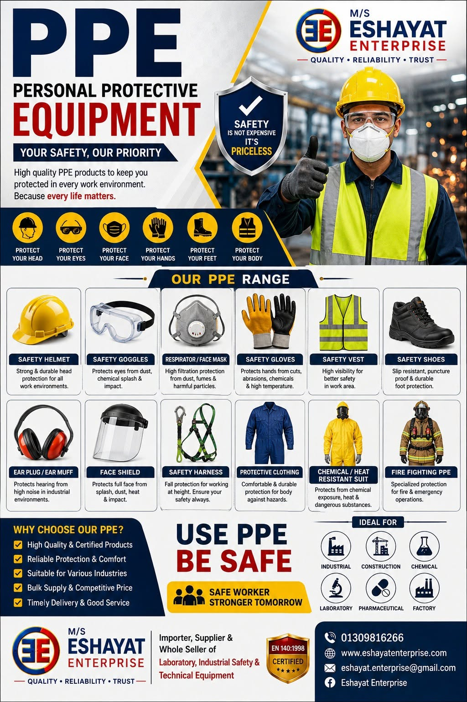

---

### Post / Item #43
- **Post/Media ID:** `122111990907425702`
- **Local Image(s):** [`images/posts/028_787287918_122111990913425702_6983803700714549973_n.jpg`](images/posts/028_787287918_122111990913425702_6983803700714549973_n.jpg)

```text
Shout out to our newest followers! Excited to have you onboard! Mergan Shuvo, Sadiq Ahmed, Obaidur Rahman Sakib, Julichia Benie, Naira Victorino Marques
```


---

### Post / Item #44
- **Post/Media ID:** `122112055047425702`
- **Local Image(s):** [`images/posts/027_787342242_122112055053425702_3345748773455310754_n.jpg`](images/posts/027_787342242_122112055053425702_3345748773455310754_n.jpg)

```text
🔬 DISCOVERY-H SINGLE-CHANNEL PIPETTES — SHIPMENT ON THE WAY! 🚚📦

Reliable laboratory pipettes are arriving soon at M/s. Eshayat Enterprise!

✨ Available Volume Ranges:
🔹 10–100 µL — Increment: 1 µL
🔹 20–200 µL — Increment: 1 µL
🔹 100–1000 µL — Increment: 5 µL
🔹 0.5–5 mL — Increment: 50 µL

✅ Single-Channel Design
✅ Half-Autoclavable Discovery-H Series
✅ Precise Volume Adjustment
✅ Suitable for Laboratory & Pharmaceutical Applications

🚢 Shipment is on the way — contact us for booking and availability!

📩 Inbox us for price & order details.

#DiscoveryH #Pipette #Micropipette #LaboratoryEquipment #LabSupplies #PharmaceuticalIndustry #LaboratorySupplies #Pipettes #Bangladesh
```

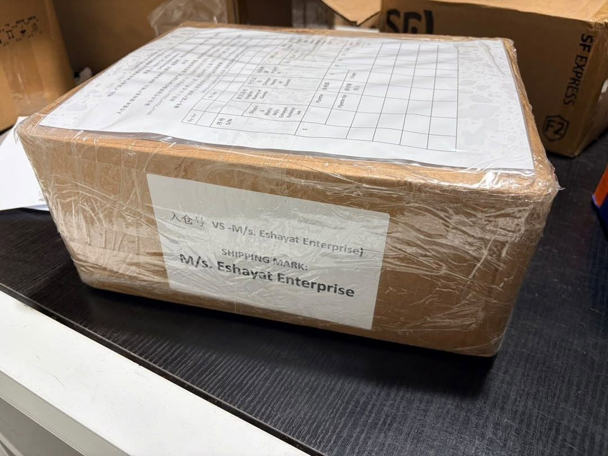

---

### Post / Item #45
- **Post/Media ID:** `122112449109425702`
- **Local Image(s):** [`images/posts/026_785288036_122112449115425702_4316094129276180161_n.jpg`](images/posts/026_785288036_122112449115425702_4316094129276180161_n.jpg)

```text
🏭 YOUR CLEANROOM PROJECT — FROM IDEA TO COMPLETION
Planning a new Pharmaceutical Plant, QC Lab, Microbiology Lab or Healthcare Facility?

✨ Let  Eshayat Enterprise build your cleanroom with confidence.

We provide complete Cleanroom Design, Construction & Installation Solutions tailored to your project requirements.

🔹 What We Provide
• Cleanroom Design & Engineering
• Modular Cleanroom Panels
• HVAC & Air Handling Systems
• HEPA/ULPA Filtration
• Cleanroom Doors & Windows
• Pass Box & Air Shower
• Cleanroom Flooring & Ceiling
• Cleanroom Lighting
• Temperature, Humidity & Pressure Control
• Cleanroom Accessories & PPE

🎯 Why Choose Eshayat Enterprise?

✅ Customized Solutions
✅ Quality Materials
✅ Professional Design & Installation
✅ Complete Project Support
✅ One-Stop Cleanroom Solution

🏆 FROM CONCEPT TO COMPLETION

WE BUILD CLEANROOMS TO YOUR REQUIREMENTS.
📞 Call: 01862679456
📧 Email: eshayat.enterprise@outlook.com
📍 1035/1, East Shewrapara, Mirpur; Kafrul PS; Dhaka-1216, Bangladesh

M/S Eshayat Enterprise
Quality • Reliability • Trust

#Cleanroom #CleanroomConstruction #CleanroomDesign #PharmaceuticalIndustry #PharmaBangladesh #QC#Laboratory #MicrobiologyLab #HVAC #HEPA #EshayatEnterprise #Bangladesh
```

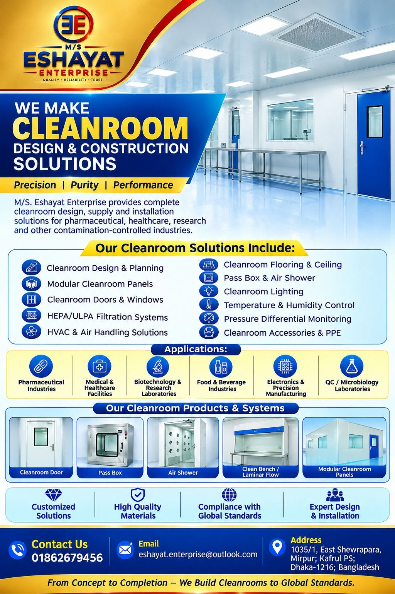

---

### Post / Item #46
- **Post/Media ID:** `122113316979425702`
- **Local Image(s):** [`images/posts/025_789446293_122113316985425702_753091509151483745_n.jpg`](images/posts/025_789446293_122113316985425702_753091509151483745_n.jpg)

```text
[Poster Text] M/S Eshayat Enterprise — PREMIUM SAFETY HELMET (Transparent High Impact ABS Shell)
• High Impact ABS Shell • Comfort Fit Suspension • Ventilated Design • Clear Visor Protection • Ratchet Adjustment
• OEM & ODM Solutions (We Manufacture. You Brand. Custom Logo, Custom Colors, Custom Packaging, Low MOQ)
Contact: +880 1887-333032 | www.eshayatenterprise.com
```

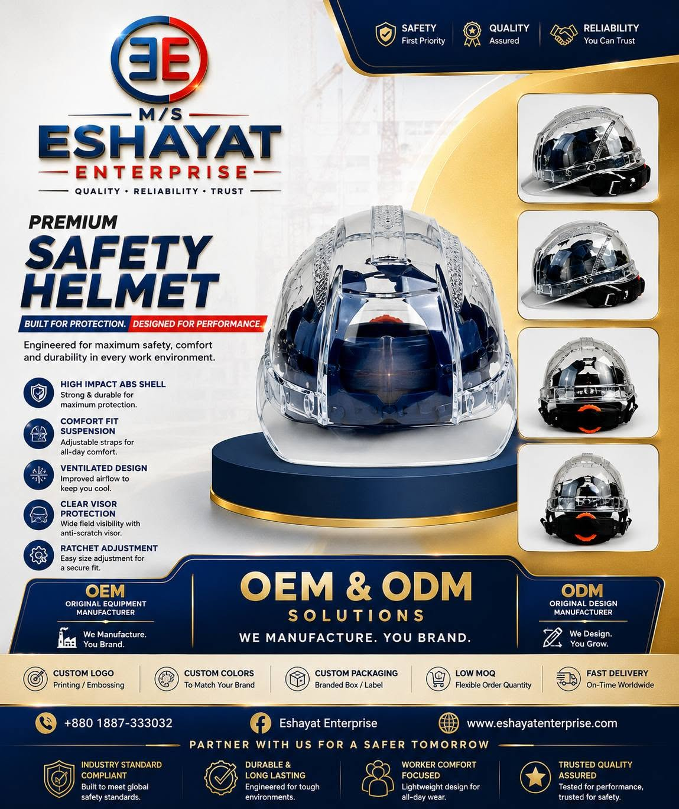

---

### Post / Item #47
- **Post/Media ID:** `122113317045425702`
- **Local Image(s):** [`images/posts/024_790226655_122113317051425702_98774340154925747_n.jpg`](images/posts/024_790226655_122113317051425702_98774340154925747_n.jpg)

```text
[Poster Text] M/S Eshayat Enterprise — PREMIUM SAFETY HELMET (Engineered for Electric & Height Work)
• EN 50365:2002 Electrically Insulating Helmet Class 0 (Up to 1000V AC / 1500V DC)
• High Impact ABS Shell • 6-Point Suspension Harness with Chin Strap • Ventilated Design • Integrated Retractable Clear Visor
• OEM & ODM Solutions (We Manufacture. You Brand. Custom Logo, Custom Colors, Custom Packaging, Low MOQ)
Contact: +880 1887-333032 | www.eshayatenterprise.com
```

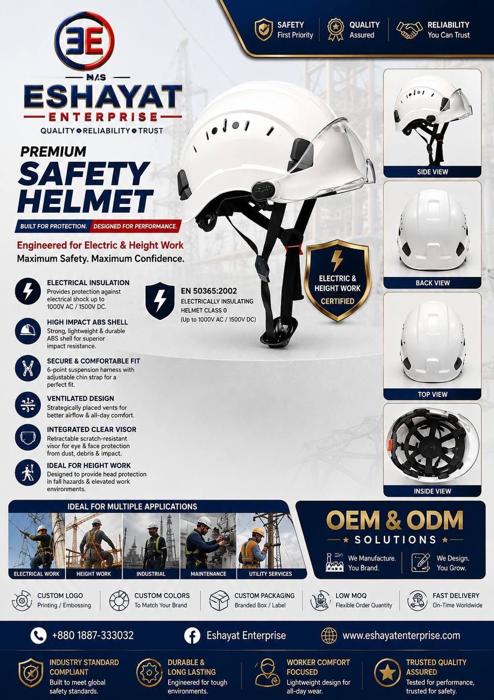

---

### Post / Item #48
- **Post/Media ID:** `122113447041425702`
- **Local Image(s):** [`images/posts/023_790317971_122113447047425702_3754475717104225991_n.jpg`](images/posts/023_790317971_122113447047425702_3754475717104225991_n.jpg)

```text
[Poster Text] M/S Eshayat Enterprise — BKMAM® / BKMANLAB® PETRI DISHES (FDA • ISO • CE Certified)
• 100% Virgin Polystyrene • 90mm x 15mm Sterile • Packing: 300 PCS / Carton (10 PCS / Pack)
Call: 01862 679456 | 1035/1, East Shewrapara, Mirpur, Kafrul PS, Dhaka-1216, Bangladesh
```


---

### Post / Item #49
- **Post/Media ID:** `122113447107425702`
- **Local Image(s):** [`images/posts/022_789925133_122113447113425702_292862388657304041_n.jpg`](images/posts/022_789925133_122113447113425702_292862388657304041_n.jpg)

```text
[Poster Text] M/S Eshayat Enterprise — BKMAM® / Labshark® PETRI DISHES (FDA • ISO • CE Certified)
• Crystal Clear High Transparency • 100% Virgin Polystyrene • Smooth & Uniform Surface
Available Sizes: 55mm | 90mm | 100mm | 150mm (Packing: 2000 PCS Per Carton for 55mm)
Call: 01862 679456 | 1035/1, East Shewrapara, Mirpur, Kafrul PS, Dhaka-1216, Bangladesh
```

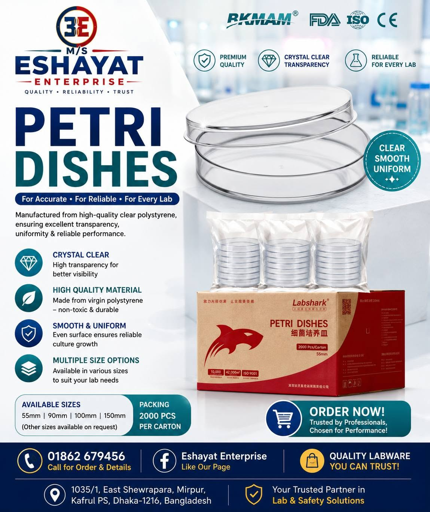

---

### Post / Item #50
- **Post/Media ID:** `122113460901425702`
- **Local Image(s):** [`images/posts/012_790397979_122113460907425702_7037705609780879949_n.jpg`](images/posts/012_790397979_122113460907425702_7037705609780879949_n.jpg)

```text
🧤⚡ PREMIUM 1000V ELECTRICAL SAFETY GLOVES ⚡🧤

Protect your hands. Work with confidence. 💪

Introducing Eshayat Enterprise Premium Safety Gloves, designed for electrical, construction, maintenance, and industrial applications.

✅ 1000V Electrical Insulation Protection
✅ Anti-Slip & Durable Coating
✅ Excellent Grip & Comfortable Fit
✅ Water Resistant & Wear Proof
✅ Suitable for Electrical, Construction, Repair & Industrial Work

🔵 BLUE 1000V
🟢 GREEN 1000V

🛡️ HIGH PROTECTION | EXCELLENT GRIP | ELECTRICAL SAFETY | WATER RESISTANT

📞 Contact: 01862-679456
📍 Address: East Shewrapara, Mirpur, Dhaka-1216, Bangladesh

📩 Message us for price & availability.

M/S. ESHAYAT ENTERPRISE
Your Safety, Our Commitment

#EshayatEnterprise #SafetyGloves #ElectricalSafety #1000VGloves #ElectricalProtection #PPE #IndustrialSafety #ConstructionSafety #WorkSafe #SafetyFirst #Bangladesh
```

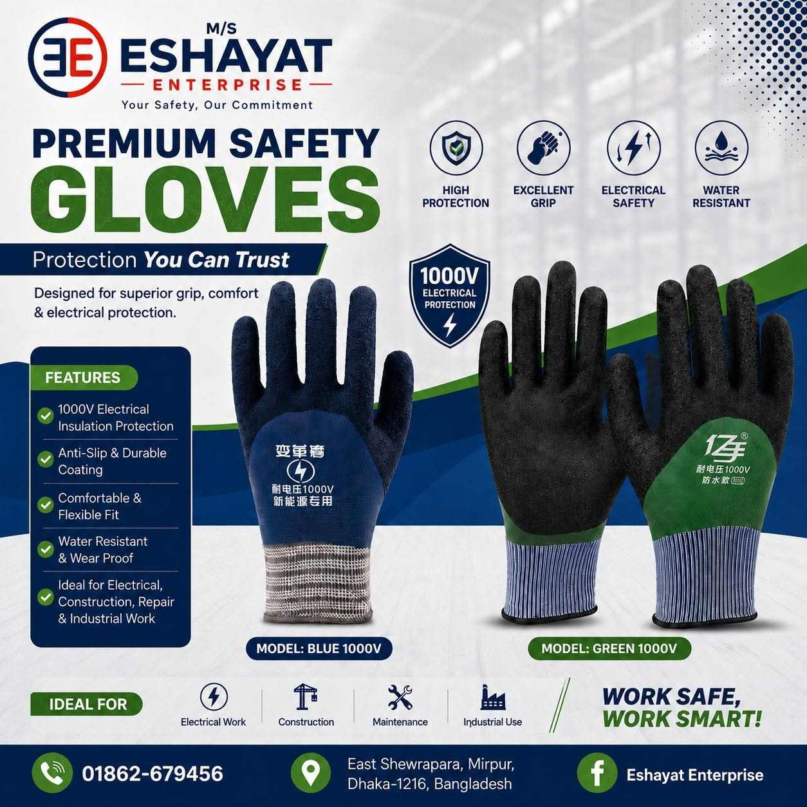

---

### Post / Item #51
- **Post/Media ID:** `122103034305425702`
- **Local Image(s):** [`images/branding/003_767793945_122103034311425702_8369019421966702579_n.jpg`](images/branding/003_767793945_122103034311425702_8369019421966702579_n.jpg)

```text
✨ Introducing our refreshed identity!
Proudly representing M/S Eshayat Enterprise — built on Quality, Reliability & Trust.
```

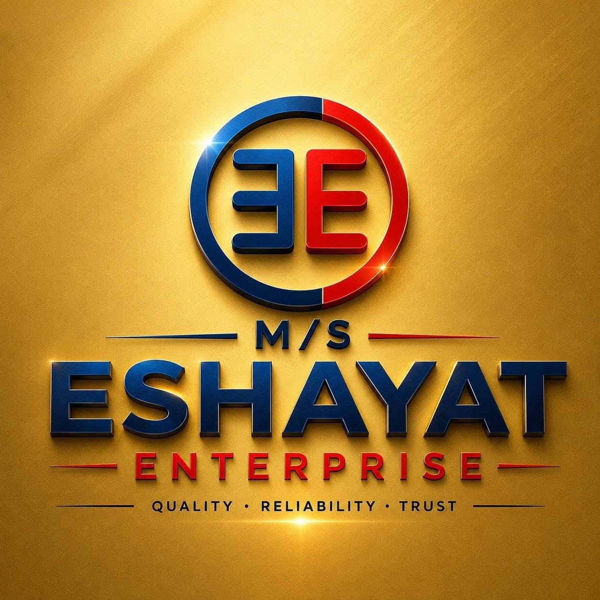

---

### Post / Item #52
- **Post/Media ID:** `122113447173425702`
- **Permalink:** https://www.facebook.com/mseshayatenterprise/posts/pfbid028218LtUWh5JETnKJFswfK621s2rsMHTNLbAWbwecShaAnp1tLUmFeh6yvb8PptWpl

```text
🔬✨ PREMIUM PETRI DISHES — FOR EVERY LAB! ✨🔬

Looking for reliable, crystal-clear Petri Dishes for your laboratory, research, clinical, educational, or industrial applications? 🧪

Introducing BKMAM & Labshark Petri Dishes — designed for dependable laboratory performance with excellent transparency and uniformity.

✅ Crystal Clear & Transparent
✅ Smooth & Uniform Surface
✅ High-Quality Material
✅ Reliable for Laboratory Applications
✅ Multiple Sizes Available
📦 500 PCS / Carton

📏 Available Sizes: 90mm & Other sizes available on request.

🏆 Quality • Reliability • Trust

📞 Call / WhatsApp: 01862 679456
📍 Address: 1035/1, East Shewrapara, Mirpur, Kafrul PS, Dhaka-1216, Bangladesh

📩 Contact Eshayat Enterprise today for price & availability!

#PetriDishes #Labshark #LaboratorySupplies #LabEquipment #LabConsumables #Microbiology #Laboratory #ResearchLab #ClinicalLaboratory #EshayatEnterprise #LabSupplies #ScienceAndSafety #Bangladesh
```

---

### Post / Item #53
- **Post/Media ID:** `122121740931425702`
- **Permalink:** https://www.facebook.com/mseshayatenterprise/posts/pfbid02mN5NtbtTyRWmctUzvM63DANLPvZaCnGm8UEjJ4yoogk3QLoUXdyFzWxLaALYzBVNl

```text
🔬 Precision Filtration. Built to Perform.
Stainless Steel Mesh Filter — engineered for efficient filtration, durability, and dependable performance across laboratory, industrial, and research applications.
✨ Key Features:
• High-quality stainless steel construction
• Fine & efficient particle filtration
• Excellent corrosion resistance
• High-temperature stability
• Long-lasting & reliable performance
• Suitable for laboratory & industrial use
📦 Available Now at M/s. Eshayat Enterprise
📞 01309816266
📍 1305/1 East Shewrapara, Mirpur; Kafrul PS; Dhaka-1216
#EshayatEnterprise #StainlessSteelMeshFilter #MeshFilter #LaboratorySupplies #LabEquipment #Filtration #ScientificSolutions #IndustrialSupplies #LabAccessories
```

---

### Post / Item #54
- **Post/Media ID:** `122120137353425702`
- **Permalink:** https://www.facebook.com/mseshayatenterprise/posts/pfbid0TP1dC9KAYmwPkmkKFF2eDYZ6EAWM1zyDzk2shtNSTCQZQUuBt6GMEPp65y8CVjT6l

```text
🚿 SAFETY SHOWER & EYEWASH STATION 👁️

Emergency Protection for Laboratories & Industries

M/s. Eshayat Enterprise brings you Safety Shower & Eyewash Stations designed for rapid emergency response when chemicals or hazardous substances come into contact with the body or eyes.

🔹 Emergency Eye & Face Washing
🔹 Full-Body Emergency Shower
🔹 Fast & Easy Activation
🔹 Suitable for Chemical & Industrial Areas
🔹 Reliable Safety Equipment for Workplace Protection

📍 Available at M/s. Eshayat Enterprise

📞 Contact: 01309816266
📍 Address: 1305/1 East Shewrapara, Mirpur, Kafrul PS, Dhaka-1216

#EshayatEnterprise #SafetyShower #EyewashStation #EmergencySafety #IndustrialSafety #LaboratorySafety #ChemicalSafety #SafetyEquipment #WorkplaceSafety #Bangladesh
```

---

### Post / Item #55
- **Post/Media ID:** `122122279005425702`
- **Permalink:** https://www.facebook.com/mseshayatenterprise/posts/pfbid02S3UHw2Z1yLaycSETsTcE9y7hHUzEkmWptTeKiNBRJ1j79fMVUcvE4iRFQiD6Ng24l

```text
🔬 Peristaltic Pump – Reliable Fluid Transfer Solution
Looking for accurate, stable, and reliable fluid transfer for your laboratory or industrial application?

M/S Eshayat Enterprise brings you Peristaltic Pump solutions suitable for:

✅ Pharmaceutical Industry
✅ Laboratory & Research
✅ Chemical Processing
✅ Water Treatment
✅ Food & Beverage
✅ Industrial Applications

Key Features:
🔹 Stable & accurate flow control
🔹 Multiple working modes
🔹 Low-noise operation
🔹 Smart touch-screen control
🔹 Durable & reliable performance

📌 Models: BT600FC & CF3000

For product details, quotation, or availability, please contact us.

📞 01862679456
📧 eshayat.enterprise@outlook.com
📍 1035/1, East Shewrapara, Mirpur, Kafrul PS, Dhaka-1216, Bangladesh

👉 Follow M/S Eshayat Enterprise for product updates and new arrivals.

#EshayatEnterprise #PeristalticPump #LaboratoryEquipment #PharmaceuticalIndustry #LabEquipment #ChemicalProcessing #WaterTreatment #IndustrialEquipment #Bangladesh
```

---

### Post / Item #56
- **Post/Media ID:** `122124305955425702`
- **Published (UTC):** `2026-10-10T14:44:28+00:00`
- **Permalink:** https://www.facebook.com/mseshayatenterprise/posts/pfbid0TMNcT6zYd1vnPo5xxiqkNw6XpjeyiWG6Pc13WhgA3s575xREU4dfx5zJwZdRKFzal
- **Local Image(s):** [`images/posts/005_843533453_122124305961425702_3721531107022596938_n.jpg`](images/posts/005_843533453_122124305961425702_3721531107022596938_n.jpg)

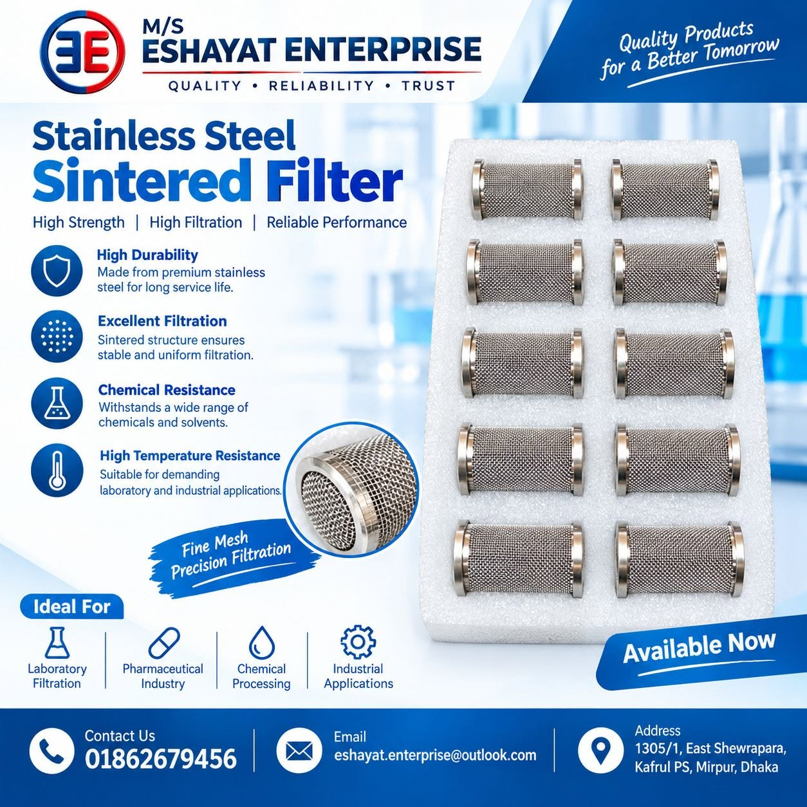

---

### Post / Item #57
- **Post/Media ID:** `122124126009425702`
- **Published (UTC):** `2026-10-09T18:37:59+00:00`
- **Permalink:** https://www.facebook.com/reel/3562516980575711/
- **Local Image(s):** [`images/posts/001_842256300_2188323435441928_430183175625155870_n.jpg`](images/posts/001_842256300_2188323435441928_430183175625155870_n.jpg)

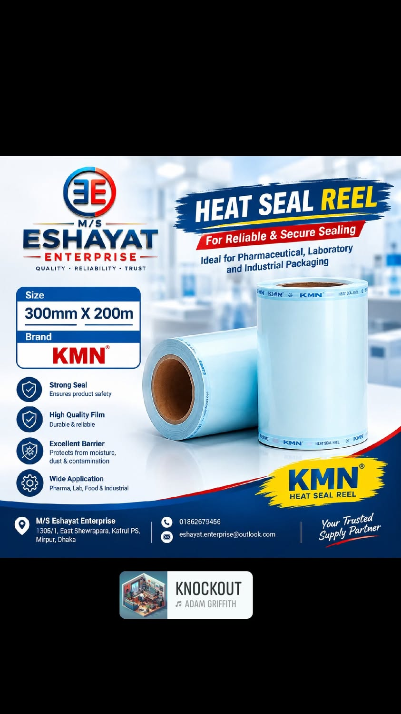

---

### Post / Item #58
- **Post/Media ID:** `122124125547425702`
- **Published (UTC):** `2026-10-09T18:35:05+00:00`
- **Permalink:** https://www.facebook.com/mseshayatenterprise/posts/pfbid0Vpsi2B5JfKSYxGooFVAdMuafDVkXaZ5RLq2LRyoj15pst9AN9nh17LbzpMbW1fLgl
- **Local Image(s):** [`images/posts/002_841533061_122124125553425702_5918737560999829888_n.jpg`](images/posts/002_841533061_122124125553425702_5918737560999829888_n.jpg)


---

### Post / Item #59
- **Post/Media ID:** `122117740581425702`
- **Published (UTC):** `2026-09-19T06:35:26+00:00`
- **Local Image(s):** [`images/posts/013_813650229_1791508148833241_7387846341595403754_n.jpg`](images/posts/013_813650229_1791508148833241_7387846341595403754_n.jpg)


---

### Post / Item #60
- **Post/Media ID:** `122106511743425702`
- **Published (UTC):** `2026-08-11T14:01:16+00:00`
- **Local Image(s):** [`images/posts/015_773612724_1601941547946767_3245731845695534274_n.jpg`](images/posts/015_773612724_1601941547946767_3245731845695534274_n.jpg)


---

### Post / Item #61
- **Post/Media ID:** `122103038511425702`
- **Published (UTC):** `2026-08-07T20:46:55+00:00`
- **Local Image(s):** [`images/posts/018_769441893_1576965184090963_7639071354036811624_n.jpg`](images/posts/018_769441893_1576965184090963_7639071354036811624_n.jpg)


---

### Post / Item #62
- **Post/Media ID:** `122103037695425702`
- **Published (UTC):** `2026-08-07T20:44:43+00:00`
- **Local Image(s):** [`images/posts/019_768941116_1519030462872892_7443009339702545995_n.jpg`](images/posts/019_768941116_1519030462872892_7443009339702545995_n.jpg)


---

### Post / Item #63
- **Post/Media ID:** `122103037413425702`
- **Published (UTC):** `2026-08-07T20:44:22+00:00`
- **Local Image(s):** [`images/posts/020_769374997_880634105131884_3731634823994215808_n.jpg`](images/posts/020_769374997_880634105131884_3731634823994215808_n.jpg)


---

### Post / Item #64
- **Post/Media ID:** `122102998701425702`
- **Published (UTC):** `2026-08-07T19:45:16+00:00`
- **Local Image(s):** [`images/posts/021_767387577_1049664224481073_2598279752165946807_n.jpg`](images/posts/021_767387577_1049664224481073_2598279752165946807_n.jpg)


---

### Post / Item #65
- **Post/Media ID:** `122102728797425702`
- **Local Image(s):** [`images/posts/062_765872470_122102728671425702_9185800020150433142_n.jpg`](images/posts/062_765872470_122102728671425702_9185800020150433142_n.jpg)


---

### Post / Item #66
- **Post/Media ID:** `122102732211425702`
- **Local Image(s):** [`images/branding/004_768148887_122102732217425702_1776836872297195546_n.png`](images/branding/004_768148887_122102732217425702_1776836872297195546_n.png)


---
